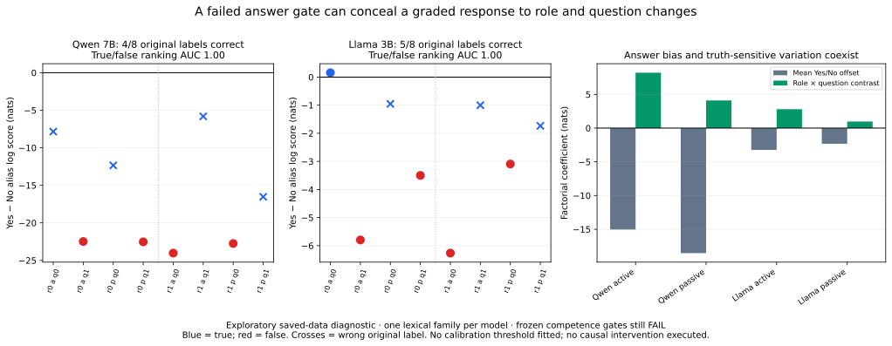

# Carrier isolation pilot and independent research reassessment

**Outcome: NO-GO for this pilot; the proposed causal routes remain UNTESTED. A post hoc output diagnostic exposes a useful measurement distinction, not a novel mechanism.**

Protocol/code/inputs were frozen and remotely verified at [978c5c3](https://github.com/Joel-Vazquez-Lopez/relational-transfer/commit/978c5c3b421b4657253c717da78dd5b9f719737c) before model inference. The previous research and failed gates were preserved. One bounded local run per model, with no training, paid API calls, downloads or subsequent adaptive model experiments.

## What was reconsidered

The original hypothesis remains coherent: different Transformers might share causal dependencies or an order of information use despite different vector spaces and timing. Existing evidence has not established that on a linguistic mechanism. The recent known-program controls cannot substitute for a pretrained-model finding. The architecture confound in the last reference study should have been addressed before execution; merely repairing that toy bank would still leave the linguistic question unanswered.

[RESEARCH_DECISION.md](RESEARCH_DECISION.md) inventories the evidence, limitations and alternative directions. [PRIOR_WORK.md](PRIOR_WORK.md) records the targeted primary-source review and what is already established. The preferred test was an operational linguistic-routing question: **is useful information already carried by a sentence token, or does it keep rereading earlier words?**

The masks separate a source-isolated period carrier from a live period relay, complete sentence disconnection, an adjacent-token carrier and irrelevant-edge removal. Known dependency schedules produce distinct predictions, and an all-layer graph certificate rules out source-information bypass at cut0 in the disconnected conditions. All later question positions are included. Source-isolated means no further source reads, not a fixed vector. Earlier question states may already contain information, so a rescue would not establish period-only sufficiency.

Strong syntax-aware copying and semantic summaries could both produce a source-isolated signature. This is explicitly a pathway test, not a semantic-essence test. It narrows the claim to something the intervention can distinguish. See the complete [frozen protocol](PROTOCOL.md).

## Actual run and prospective stop

Four fresh constructed name/verb families were tokenized per model; only the first development family was evaluated. Its eight questions cross role assignment, voice and later question orientation. The answer label is balanced and changes independently of the sentence prefix. Example: “Julia greeted Mark.” / “Did Julia greet Mark?” / gold Yes.

| Model | Original correct next-token labels | Fully competent development families | Actual forwards | Causal intervention forwards | Evaluation forwards |
|---|---:|---:|---:|---:|---:|
| Qwen 7B | 4/8 | 0/1 | 11 | 0 | 0 |
| Llama 3B | 5/8 | 0/1 | 11 | 0 | 0 |

Each model made eight scientific baseline calls and three numerical-validation calls. Qwen chose No in all8 cases. Llama chose Yes only on the first true active case; all other predictions were No. All predictions were valid Yes/No tokens; there were no unexpected-vocabulary outputs, refusals or missing payloads. Seven of16 primary answers failed the frozen criterion. All failures are in [FAILURES.json](FAILURES.json); every answer is in [ANSWER_LEDGER.csv](ANSWER_LEDGER.csv).

The frozen competence rule requires all8 labels correct. Both models therefore stopped before the first causal intervention, development site selection or evaluation call. All three evaluation lexical families per model remain output-unobserved. A missing intervention effect is **unmeasured**, not zero. Cached/live/other routing hypotheses have not been falsified or supported by this run.

## Technical validity

For both models, unwrapped/wrapped-native/dense-baseline/repeat original-end logits match exactly. Repeated measured residual traces match exactly. All four same-sentence period-trace comparisons across later questions match exactly. The16 reported numerical checks pass, but they do not supply task competence or count as intervention controls.

The independent saved-data audit checks all22 full-vocabulary logit vectors, payload hashes, original grammar labels, alias scores, unconstrained argmax, margins and correctness. It also reconstructs native/dense/repeat and period-prefix nulls. All40 audit checks pass; independent alias-score discrepancy is below1e-10. The audit loads no model and runs no new forward. Frozen source hashes remain unchanged.

The anticipated cut0 disconnection, neutral-source, neighbor, sham-cut and before-cut **empirical** intervention checks were not reached. Their offline mask/path tests passed; those tests are not empirical model-control passes.

## Exploratory diagnostic: the failed label threshold is not the whole response

After the prospective stop, inspect the already saved continuous output scores. Define `s = logsumexp(Yes aliases) − logsumexp(No aliases)`. No new threshold is fitted or substituted into the original gate.

| Model | Original labels correct | True statements outrank false statements | Smallest true score minus largest false score |
|---|---:|---:|---:|
| Qwen 7B | 4/8 | 16/16 pair comparisons; descriptive AUC1.00 | +5.9531 nats |
| Llama 3B | 5/8 | 16/16 pair comparisons; descriptive AUC1.00 | +1.3594 nats |

These are four true and four false statements about **one lexical family per model**. The16 rank comparisons reuse the same eight scores; they are not16 independent examples or a population estimate. Perfect ranking on this small exposed set does not validate calibration, generalization or a semantic mechanism.

Nevertheless, the inference “it answered No, therefore it ignored the role/query change” is false for these scores: both models' output preferences vary systematically with the controlled truth conditions. Their unchanged native answer boundary still produces wrong labels. This is compatible with a decision offset, surface heuristics, wording sensitivity or richer processing. It does not show that one universal constant bias is the cause, and does not prove the model represents semantic roles abstractly.

An exact2×2 decomposition per voice separates the overall Yes/No offset, role main effect, query main effect and role×query interaction. With role/query sign coding chosen so their product indicates truth, the interaction is positive in all four model/voice cells:

| Model/voice | Overall offset | Role×query coefficient |
|---|---:|---:|
| Qwen active | −15.0430 | +8.2148 |
| Qwen passive | −18.5391 | +4.1016 |
| Llama active | −3.2266 | +2.8047 |
| Llama passive | −2.3203 | +0.9766 |

These coefficients are algebraic contrasts, not fitted latent variables or causal components. A fixed answer-label bias or role-only/query-only additive output model cannot reproduce the interaction. A syntax-aware or contextual copying model can. No whole-development interpretation is inferred from final output coefficients.

In the plot, r0/r1 select which participant is Agent; q0/q1 reverse the question's actor/object order; a/p denote active/passive voice. Separate model panels retain native score scales. No line shows a retrospectively chosen decision threshold.

## An adversarial check against a convenient universal explanation

A saved-data-only diagnostic also covers all already exposed32 Atlas answers per model from the previous repaired pilot. Its original scoring/gates remain unchanged; no old held-out material is evaluated. Pooled rank results include:

| Old demand | Qwen original correct /8; AUC | Llama original correct /8; AUC |
|---|---|---|
| Agent | 8;1.000 | 8;1.000 |
| Theme | 8;1.000 | 7;.833 |
| Goal | 8;1.000 | 2;.750 |
| Mention order | 4;.625 | 5;1.000 |

The Agent labels are constant within each lexical family; their pooled rank score is therefore confounded with family identity and is not evidence of within-family relation discrimination. The JSON records within-family scores and undefined single-class cases explicitly. Most importantly, Qwen's old order failure and Llama's old Goal failure do **not** admit a perfect global separating threshold on their exposed scores. We cannot claim that calibration repairs all previous failures or that every earlier failed screen was merely a readout problem.

Full exploratory inputs, individual scores, rank comparisons, factorial coefficients, old-source hashes and caveats are in [EXPLORATORY_READOUT_AUDIT.json](EXPLORATORY_READOUT_AUDIT.json). No decision threshold, prompt, model or intervention was repaired after outcomes.

## What this means for the research

The useful lesson is to distinguish **graded sensitivity to a controlled relationship**, **correct output decisions**, and **causal dependence on a particular pathway**. They are separate empirical questions. Here we observed a limited graded output distinction and failed the output-decision prerequisite; we did not reach pathway testing. This is a sharper measurement diagnosis than concluding that the linguistic process does not exist, or calling the failed gate a success.

There is close prior work. [Zhao et al.2021](https://proceedings.mlr.press/v139/zhao21c.html) already studies answer-label calibration; [Holtzman et al.2021](https://arxiv.org/abs/2104.08315) already studies limitations of raw answer probabilities. We have not introduced calibration, implemented their methods here, or demonstrated an equivalent cause. [Geva et al.2023](https://aclanthology.org/2023.emnlp-main.751/) already traces staged information routes with attention-edge interventions. [Dai et al.2024](https://aclanthology.org/2024.emnlp-main.967/) already identifies binding-related representations and causal retrieval edits. Our pilot supplies no new binding mechanism or superiority over these results.

Likewise, [Wei et al.2026](https://arxiv.org/abs/2609.11859) already distinguishes routing readability, strength and causal use in factual retrieval with nonuniform model trajectories. The potential future contribution must be a specific validated relationship in contextual linguistic processing, with convincing prospective controls—not the generic statement that readable information and causal use differ.

The next justified **design**, outside this completed study, would establish a development-only readout and a bias-cancelling factorial sensitivity criterion, validate both on fresh lexical/construction units, then freeze the pathway predictions. A changed primary endpoint is a new investigation; it cannot be retroactively applied to run these skipped interventions. Both direct-answer reliability and graded response must be reported. A calibrated-score success alone is not evidence of native correct answering. There is no reason yet to invent a new similarity measure or claim a common universal computational path.

**My assessment:** the research question remains viable; the paper claim remains unsupported. This run contributes a concrete instrument design, an honest failed feasibility test, and a bounded output diagnostic that explains why this particular failure is more informative than its accuracy alone. It does not guarantee a paper. The final decision is NO-GO for the pilot, with the operational carrier hypotheses unresolved. Stop here; no adaptive follow-up inference.

## Complete artifacts and reproduction

- Frozen inputs, token offsets, source regions, aliases, annotations, model/runtime hashes and preflight tests are committed with the protocol.
- RAW.json files include every scientific and technical call, full-vocabulary argmax, alias logits, top20 and payload hashes. BUDGET.json records attempts before execution. No attempt lacks a saved result.
- [COMPLETE_RAW_ARRAYS.tar.gz](COMPLETE_RAW_ARRAYS.tar.gz) contains all22 original-end full-vocabulary logit arrays and all22 measured-state archives, losslessly. The two unwrapped calls intentionally have empty measured-state arrays. Original per-call files are also retained locally. Model weights are excluded; all measured tensors are preserved. RAW_ARCHIVE.json records checksum, size and members.
- All original numerical controls, competence decisions, console logs, the40-check independent audit, answer/failure ledgers, diagnostic JSON, PNG/SVG/PDF and complete scripts are preserved. No large-array upload is omitted in this completed small run.

Reproduce in a separate copy, with the existing local MLX environment and model files. `prepare.py` is inference-free and freezes a new empty copy. Actual `run.py qwen7b` / `run.py llama3b` requires the freeze receipt and refuses repeated starts. Do not erase start markers or overwrite this run. `audit_and_report.py` reads saved arrays only and regenerates exploratory diagnostics/plots/archive; its source was written after outputs and is not presented as prospective analysis. The protocol's primary rules were frozen before inference.
