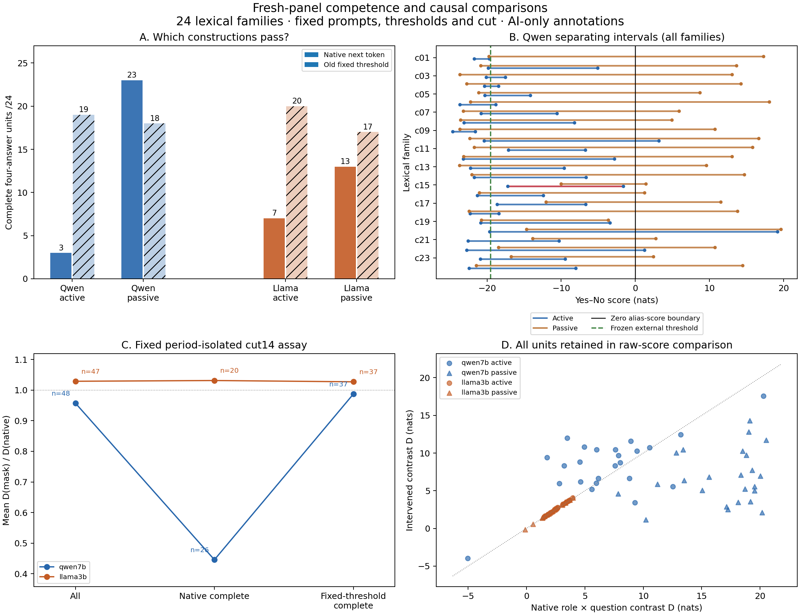

# Prospective competence-selection confirmation

## Decision

**NARROW: the prespecified construction-dependent screen effect replicated in this panel. No new linguistic mechanism is established.**

One frozen experiment:24 fresh lexical families ×8 role/voice/question prompts ×2 existing local quantized checkpoints. No answer-based collection exclusions, threshold refits, site changes, retries or follow-up model experiments. The pre-output source freeze is [a376dcf](https://github.com/Joel-Vazquez-Lopez/relational-transfer/commit/a376dcf46e4d2bc26fe592ace1fe674683c5dcf9). All15 frozen publication files were verified before the first new forward.

## Complete native and fixed-threshold results

A unit is four role×question answers for one family and one voice. A family contains two units. These are AI-authored synthetic sentences, not natural documents. Native means vocabulary-wide first-token argmax, not full generated responses. The fixed external classifier is a different decision rule.

|Checkpoint|Construction|Native answers /96|Fixed threshold /96|Native complete units /24|Fixed-threshold complete units /24|Separable units /24|
|---|---|---:|---:|---:|---:|---:|
|qwen7b|active|55|89|3|19|23|
|qwen7b|passive|95|87|23|18|24|
|llama3b|active|69|91|7|20|24|
|llama3b|passive|78|86|13|17|23|

## Sole confirmatory test

For each Qwen lexical family, d = (calibrated−native complete-active indicator) − (calibrated−native complete-passive indicator). Positive:19; negative:0; tied:5. Mean d:0.8750. Prespecified one-sided exact family sign test **p=1.9073486e-06**, alpha .05; criterion passed.

This p value is conditional on independent/exchangeable family signs under the null. The24 families are an authored fixed list with shared templates, not a randomized linguistic population. It is not a probability that the hypothesis is true, proof of generalization, or a novelty test. No separate Llama, answer-level, layer-level or secondary p values were calculated.

### Every family-level primary outcome

|Family|Qwen d|Llama d (descriptive)|Qwen native whole-family /1|Qwen calibrated whole-family /1|Llama native whole-family /1|Llama calibrated whole-family /1|
|---|---:|---:|---:|---:|---:|---:|
|c01|0|1|0|0|0|1|
|c02|1|-1|0|1|0|1|
|c03|1|0|0|1|0|1|
|c04|1|1|0|1|0|0|
|c05|1|0|0|1|1|1|
|c06|1|1|0|1|0|1|
|c07|1|1|0|1|0|1|
|c08|1|2|0|1|0|0|
|c09|0|-1|0|0|0|0|
|c10|0|0|1|1|1|1|
|c11|0|2|0|0|0|0|
|c12|1|0|0|1|0|1|
|c13|1|1|0|1|0|1|
|c14|1|-1|0|1|0|1|
|c15|1|1|0|0|0|0|
|c16|1|1|0|1|0|1|
|c17|1|0|0|0|0|0|
|c18|1|0|0|1|0|1|
|c19|0|2|0|1|0|0|
|c20|1|-1|1|0|0|1|
|c21|2|-1|0|0|0|0|
|c22|1|0|1|0|1|1|
|c23|2|0|0|0|1|0|
|c24|1|1|0|1|0|0|

## Fixed causal comparison: does the earlier gap illustration reproduce?

The assay is the old source-isolated period mask at cut14. D is the four-answer role×question contrast of the Yes−No alias score. Retention is D_mask/D_native, undefined for |D_native|<.5. The mask and score are identical across gates: only eligible rows change. Selected means estimate different conditional samples, not changes in the model.

|Gate|Support policy|Qwen mean retention (valid n)|Llama mean retention (valid n)|Llama−Qwen|
|---|---|---:|---:|---:|
|all|own_selected|0.9574 (48)|1.0291 (47)|0.0718|
|all|common_selected|0.9574 (48)|1.0291 (47)|0.0718|
|native_complete|own_selected|0.4455 (26)|1.0316 (20)|0.5860|
|native_complete|common_selected|0.4520 (15)|1.0368 (15)|0.5848|
|calibrated_complete|own_selected|0.9872 (37)|1.0274 (37)|0.0401|
|calibrated_complete|common_selected|1.0914 (30)|1.0211 (30)|-0.0703|

Own-selected gap shift (native-gated minus all): **0.5143**. The frozen descriptive replication criterion was a positive shift ≥.10: **met**. Common native-gate gap shift:0.5130; same positive direction. These are descriptive comparisons with no secondary significance test.

The earlier post hoc example was .2831→.5320. A successful primary selection test does not make that causal-gap illustration a replicated finding; the secondary criterion is judged separately. Full raw D means, medians, denominator exclusions, negative native D, common selections, whole-family gates and closed/irrelevant masks are all retained in RESULTS.json. Inspect `ratio_units` separately from selected units: a common gate is not automatically common valid-denominator support.

## Why a native failure is not automatically a relational deficit

- **qwen7b:**22/48 native-incomplete units;17 have a separating interval containing the old fixed threshold;4 are separated but that threshold misses;1 have overlapping/tied Yes/No ranges. Baseline off-label argmax answers:0. Every unit's offset, R/Q terms, D and interval is in UNIT_LEDGER.csv and RESULTS.json.
- **llama3b:**28/48 native-incomplete units;22 have a separating interval containing the old fixed threshold;5 are separated but that threshold misses;1 have overlapping/tied Yes/No ranges. Baseline off-label argmax answers:0. Every unit's offset, R/Q terms, D and interval is in UNIT_LEDGER.csv and RESULTS.json.

A separating interval shows only that these four final scores can be classified by a scalar boundary. It does not show native correctness, an internal calibrated posterior, or a specific semantic mechanism. The question and correct answer already determine role orientation on this binary support; syntax-aware copying and output preparation remain competing accounts.

## Numerical and preservation audit

- **1562/1562** actual forwards,781 per checkpoint, including native-wrapper/repeat, sham and cut0-disconnection controls.
- **2520 production numerical checks** passed; **6752 independent replay checks** passed. No numerical gate was loosened and no frozen source changed.
- Every attempt was journaled before dispatch; every full output vector was saved losslessly before scoring. Raw outputs include all wrong, off-label, surprising and intervention-produced answers. Native residual traces have all29 stages at period and answer; intervention traces have five saved anchors plus full-trace hashes.
- The archive manifest/shards reconstruct every1562 original NPZ files with per-member SHA256 verification. Full token-prefix arrays were stored as hashes, not values. No KV, attention or MLP writes were captured here.
- No paid calls, downloads, model training or extra adaptive panel. Existing branches/previous failed gates are preserved. The synthetic1562-call controller rehearsals and small algebra tests are not counted as empirical model forwards.

## Relation to prior work and the original research objective

This supplies a measurement audit for the Linguistic Development Observatory: define the target population and report construction-stratified evidence before interpreting a cross-model map built from correctness-filtered examples. It does not reconstruct how meaning develops inside a Transformer. One fixed cut cannot establish the temporal order of all functions.

[Jenner et al.(2024)](https://papers.nips.cc/paper_files/paper/2024/file/37d9f19150fce07bced2a81fc87d47a6-Paper-Conference.pdf) already report a structural shift in a filtered chess interpretability dataset; the general selection concern is not new. [Zhao et al.(2021)](https://proceedings.mlr.press/v139/zhao21c.html) already studies external calibration, and [Zhang & Nanda(2024)](https://arxiv.org/abs/2309.16042) establishes assay/metric sensitivity. [Dai et al.(2024)](https://aclanthology.org/2024.emnlp-main.967/) provides causal binding-subspace results that our present binary assay does not identify or replace. See LITERATURE_SCOPE.md for the precise narrower comparison.

No universal mechanism, family-wide difference, novel calibration method or publishable-paper result is claimed. Active/passive alternation bundles tokens, length and position; AI argument labels are not uniformly strict Agent/Patient thematic roles. See LIMITATIONS.md and ANNOTATION_LIMITATIONS.md. The exact selection decomposition is a supplementary descriptive calculation, not another confirmatory test or causal mediation identification.

## Reproducible artifacts

- PROTOCOL.md, LOCK.json, FREEZE_RECEIPT.json: frozen predictions/inputs/sources and pre-inference GitHub receipt.
- SOURCE_MANIFEST.json, TOKENIZER_AUDIT.json: all24 lexical families, annotation uncertainties and freshness scope.
- ANSWER_LEDGER.csv, UNEXPECTED_ANSWERS.json, per-model RAW.jsonl and BUDGET.jsonl: every original answer and attempt.
- UNIT_LEDGER.csv, FAMILY_LEDGER.csv, RESULTS.json: individual scores remain separate from complete units and families.
- INDEPENDENT_AUDIT.json, per-model CONTROLS.json, DECISION.json: numerical and score-replay checks.
- CONFIRMATION.png/svg/pdf: descriptive figure; plot.py reproduces it.
- SELECTION_DECOMPOSITION.json: all fixed masks/gates, with construction-mixture and within-construction selection terms.
- PAYLOAD_ARCHIVE_MANIFEST.json and PAYLOADS.partNNN: all original full-output/trace NPZ payloads, losslessly reconstructable.

**Collection is complete. No additional inference follows this report.**

## Critical follow-through: what the positive result does and does not repair

**Calibration is not a universal repair.** Qwen active accuracy improves55→89/96, but passive falls95→87/96. On complete units,16 active units are rescued and none lost; passive gains1 and loses6. Thus the primary relative-improvement effect includes both active rescue and passive harm. It must not be summarized as recovery of all native competence. Llama also loses some previously complete units under its fixed threshold. All losses remain in the ledgers.

**The native error asymmetry is visible on explicit positive assertions.** Qwen answers only7/48 entailed active Yes cases correctly, versus47/48 passive Yes cases; all48 converse No cases are natively correct in each voice under the assigned directed-event convention. The threshold changes these to46/48 and48/48 Yes cases, while producing false positives on No cases. This is a final-output observation, not proof of an internal bias circuit.

**The score difference is not simply a uniform additive shift.** Qwen mean Yes−No scores for gold-Yes cases are−7.1631 active versus12.4001 passive; the corresponding gold-No means are−21.1794 versus−21.1755. Mean D also changes7.0081→16.7878. A shift of every score by the same construction-specific constant would preserve D and cannot explain this full pattern. Aggregate near-equality of the No means does not imply per-family or layerwise invariance. Conditional-score algebra is saved in CONDITIONAL_SCORE_DIAGNOSTIC.json.

**The secondary shift survives matched denominators and is not one-family-only.**
- joint_valid_denominators: 47 common full-panel units, 15 common native-complete units; gap 0.0639→0.5848, shift+0.5209.
- joint_positive_and_ordinal: 46 common full-panel units, 15 common native-complete units; gap 0.0595→0.5848, shift+0.5253.
- Leaving out each family in turn gives shifts from+0.4262 to+0.5482; all24 omitted-family results are retained. This is descriptive outlier sensitivity, not a new statistical test.
- The difference of model median retentions changes .2722→.6108, and the raw intervened-D gap changes−5.0811→−4.4563. Different summaries have different units/estimands; no alternative metric replaces the frozen mean-ratio endpoint.

**The control effects are assay-specific.** Native filtering changes the closed-source mean-ratio gap1.0131→1.0230 and the irrelevant-span gap−.0836→−.0095. The much larger shift belongs to the period-source-isolated assay; it is not a universal increase under every mask. Neutral-span deletion itself has real drift and is not an identity intervention. All effects are saved, not treated as technical failure.

**Exact descriptive decomposition:** of the+0.5143 own-selected gap shift, 0.4237 comes from changed active/passive weights using full-panel construction means as reference, and 0.0905 from selection within constructions. The split depends on that stated reference; it is arithmetic about the report, not a causal mediation decomposition of model processing.

**Annotation uncertainty matters.** Both checkpoints' one inseparable unit belongs to c15 (*accompany*), flagged for reciprocity ambiguity during collection before outcomes were inspected. This is weak evidence for a linguistic discrimination deficit. All24 families remain in the primary test; omitting c15 only as a labeled descriptive sensitivity leaves the gap shift+.5321, and omitting both c09/c15 leaves+.5168. No additional p values or relabeling were introduced.

**Endpoint/storage audit:** the inherited native scorer also checks the aggregate alias margin; on all384 scientific baselines that extra condition agrees exactly with vocabulary-wide argmax correctness (zero discrepancies). Independent saved-tensor verification passed7570 checks, in addition to the frozen6752 score/journal checks and2520 production controls. Complete vectors, native full-depth traces, nonnative saved anchors and reconstructable archives passed their stated checks. Hash-only omitted arrays remain unrecoverable.

*Figure:* A shows complete-unit admission, B shows the open separating intervals (red means no separating interval), C uses the frozen mean-retention endpoint with valid-denominator counts, and D retains every raw native/intervened contrast. No panel is a new significance test.

**Practical conclusion:** this is a reproducible measurement finding worth building on. A correctness-filtered cross-model comparison can change sharply because it changes the linguistic sample being compared, even when both models are evaluated on the same selected subset. It does not yet reveal a distinct event-selection or linguistic-development mechanism, and direct selection precedent prevents a broad novelty claim. No further model inference follows.
