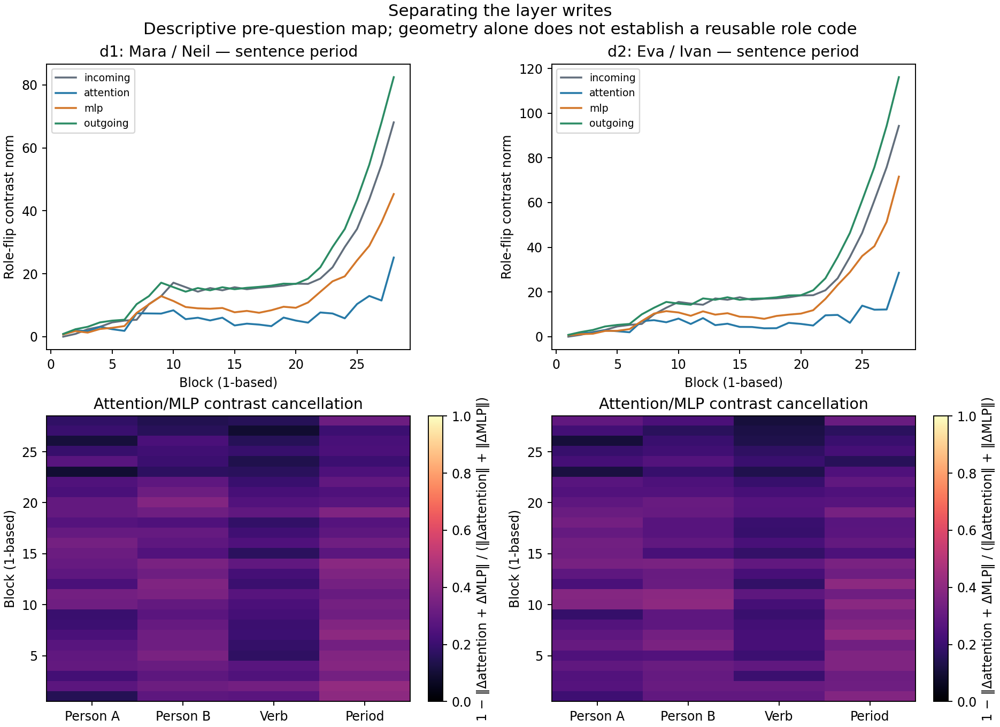

# Component reuse pilot — 18 October 2026

**NO-GO for this pilot. Frozen outcome: STOP_COMPETENCE.** 161/192 baseline answers pass both generation and score checks; 0 component patches executed.

## What was tested

One existing local Qwen2.5-7B-Instruct model (4-bit MLX); four constructed lexical families, six active/passive/cleft sentences, Agent/Patient/first-person/last-person questions, and reversed X/Y answer codes. The question and output mapping follow the measured sentence. This corrects the earlier person-only prompt conflict. These are fresh prompts, not a natural-corpus sample or a preregistration deposited with an independent registry.

The pre-output protocol and full runner hashes were saved in RUN_STARTED.json before loading the model. PROTOCOL.json declares the complete gates, twelve candidate locations, controls, selection rule and 400-patch maximum. The strongest syntax-aware compound-key rival is explicitly allowed to survive even a successful pilot.

## Competence: individual answers, units and families

| Family | Split | Correct answers | Entire family correct? |
|---|---|---:|---|
| d1 | development | 40/48 | False |
| d2 | development | 39/48 | False |
| e1 | evaluation | 42/48 | False |
| e2 | evaluation | 40/48 | False |

Entire-family failures: 4/4. These constructed families are the document-level units; individual answers are not independent documents.

| Family | Orientation | Correct prerequisite answers | Eligible? |
|---|---|---:|---|
| d1 | a | 17/24 | False |
| d1 | b | 23/24 | False |
| d2 | a | 18/24 | False |
| d2 | b | 21/24 | False |
| e1 | a | 18/24 | False |
| e1 | b | 24/24 | True |
| e2 | a | 18/24 | False |
| e2 | b | 22/24 | False |

| Answer-code mapping | Correct answers |
|---|---:|
| normal | 89/96 |
| reversed | 72/96 |

All 192 prompts, token positions, raw generations, X/Y log probabilities and failures appear in BASELINES.json. ANSWER_LEDGER.csv, BASELINE_FAILURES.json and UNIT_LEDGER.csv provide separate views. No error was repaired by changing the prompt or substituting a family.

## Technical checks

Maximum relative reconstruction error: 0.00041882271 (limit 0.002). Maximum pre-question discrepancy across query/code prompts: 0.0053798027 (strict limit 0.001). Maximum measured identity-patch margin discrepancy: untested (limit 0.05 nat; 0 measurements). Empty identity checks are untested, not a successful causal control.

The prefix-invariance check independently fails its frozen tolerance. The common sentence prefix should be invariant in the causal architecture; this discrepancy cannot be interpreted as the model using a future question. Numerical execution sensitivity or a measurement issue is possible, but its source was not established here. No new diagnostic model runs or relaxed tolerances were used to rescue the study. The component map therefore has an additional technical limitation beyond the competence failure.

## Causal decision

Decision: **STOP_COMPETENCE**. Selected location: `None`. Development candidates scored: 0. Held-out unit/mapping results: 0.

DEVELOPMENT_DECISION.json reports every candidate, including unsuccessful ones. PATCHES.json preserves every measured intervention and unconstrained greedy next token. RESULT.json separates held-out unit/mapping outcomes and all frozen criteria. Controls not executed after a gate stop remain untested; their absence is not a null effect.

## Layer instrument

The declared descriptive instrument captures incoming residual, attention output, MLP output and outgoing residual at every one of 28 blocks and six token anchors in both development families, all six sentences. The compressed float32 archive preserves native captures without an additional float16 save. Its checksum is in RESULT.json. Capture as float32 does not undo quantization or native arithmetic error.

COMPONENT_LEDGER.csv reports every development family × three declared contrasts × block × six sites (1,008 rows). The map shows norms and attention/MLP cancellation for the same-name-order role flip. A high cancellation value means opposing component contrasts can obscure a net write; it does not identify a role representation or demonstrate transfer. Entity-anchored positions can occur at different absolute locations, and passive/cleft changes alter several syntactic and lexical features. No geometry threshold is used to invent an additional success.

## Interpretation and prior research

A gated failure rejects continuation of this particular single-write design, not the existence of distributed relational computation. It leaves open distributed multi-token mechanisms and different constructions, but this pilot does not test or validate them. It also does not establish shared development across models: only Qwen 7B is used.

[Dai, Heinzerling and Inui (2024)](https://aclanthology.org/2024.emnlp-main.967/) already localize low-rank binding information and redirect entity–attribute retrieval by editing it. Our intended advance would require a selective pre-question dependency that survives both role questions, surface-order controls, answer recoding and untouched lexical cases. Generic activation redirection or a similar-looking curve is insufficient for novelty. [Mixing Mechanisms](https://arxiv.org/abs/2510.06182) further motivates testing multiple retrieval explanations rather than assuming one semantic mechanism. A strong syntax-aware compound-key account remains compatible with even the intended success pattern.

## Scope and preservation

This is a small constructed pilot with competence-based exclusions, no population estimate, no cross-model replication and no unique-mechanism conclusion. All exclusions are exposed. No training, large download or paid API call was used. No adaptive follow-up is part of this run. Scripts, complete raw text outputs, controls, protocols and figures are preserved on the existing research branch and linked to Issue #33. The full component archive is saved locally with its SHA256 manifest; model weights are not uploaded.

Reproduce using the existing MLX environment: `python run.py` in a clean copy without RUN_STARTED.json. The run refuses to overwrite a prior start. `python analyze.py` regenerates descriptive tables and the figure from completed outputs. Reproduction is not authorization for an additional run here.
