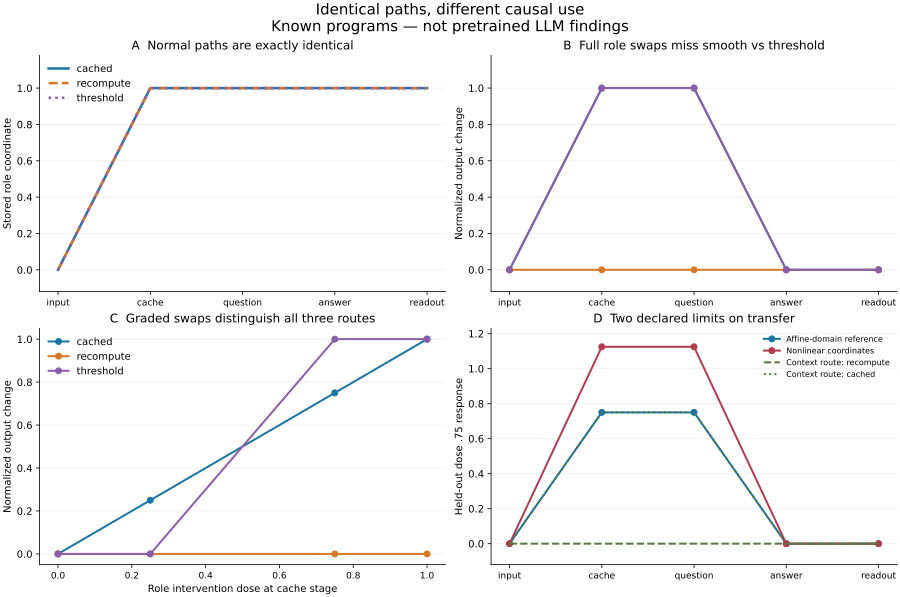

# Identical paths can hide different causal use

**Decision: NARROW methods result.** The frozen comparison distinguishes the declared synthetic routes under the declared affine encodings and intervention family. It fails to provide unrestricted coordinate invariance or global equivalence under context change. No new pretrained-model experiment was run; no novel linguistic mechanism, cross-model law or publishable novelty is established.

Protocol/source frozen at [335619dec87fe87731e9c0342c9319188869eef9](https://github.com/Joel-Vazquez-Lopez/relational-transfer/commit/335619dec87fe87731e9c0342c9319188869eef9), before benchmark execution. Prior results and failed gates remain intact. This is the complete bounded experiment authorized for this turn; no adaptive follow-up was run.



Lines connect sampled stages/doses; the threshold response between tested doses was not sampled.

## What we actually executed

Three central programs share every observed natural state and normal answer, but differ in whether their answer uses a cached role, recomputes from raw inputs, or thresholds the cache. A fourth has a context-dependent route. Six coordinate/schedule variants challenge the cached program comparison. All are hand-written scalar programs, not trained Transformers or genuine natural language.

- **80 program instances**: ten specifications × eight seeds. Each has 64 normal cases per split.
- **5,120/5,120 held normal outputs correct**. These are deterministic ±1 answer coordinates, not generated language answers.
- **387,072 saved intervention outcomes** across both splits, all stages and seven channels. Raw normalized effects retain each case; absolute outputs can be reconstructed as clean Y × (1−2 effect), using the case-manifest clean Y, up to encoding/decoding roundoff. Per-intervention unnormalized floating-point readouts were not separately saved; the normalized effects are the primary raw outcome.
- **402 arrays**, 962,832 stored entries: complete natural states, effects, availability and case factors. The compressed NPZ is preserved locally and uploaded as a binary Git blob.
- **64 operational DSA comparisons**, all completed; one independent preflight DSA self-check returned zero.
- **96/96 independent oracle checks passed**, including exact observational clones and case-by-case/stage-by-stage/channel-by-channel causal equations for all four base routes, plus the predicted nonlinear overshoot.
- Sham effect exactly zero; maximum nuisance-control effect 4.22e-15. All 80 instances passed their held normal-output screen. Program instances and individual answers are different units.

Core calibration uses seeds 11 and 23. Six held seeds yield 42 pair comparisons: five positive transformations and two negative routes per seed. These parameterizations are not independent linguistic datasets; no statistical population claim follows from 42/42.

## Identification ladder

| Information/intervention family | Can distinguish cached from recompute? | Can distinguish smooth cached from threshold? |
|---|---|---|
| Complete normal paths and outputs | No: identical | No: identical |
| Whole-state swaps | No: consistent donor updates both possible routes | No |
| Targeted role and input swaps at full dose | Yes | No |
| Add graded role interventions | Yes | Yes, on continuous output response |

After cache and before answer, a full role swap changes cached and threshold answers, but leaves recompute unchanged. A raw-order swap gives the complementary dependence pattern. At dose .25, smooth cached changes by .25, threshold by zero; at dose .75, responses are .75 and one. Thus a positive answer-switch intervention alone does not establish the underlying response rule.

This hierarchy was predicted from known equations. It is a calibration of what the measurement observes, not an unexpected discovery about learned computation.

## Fixed stage correspondence results

Alignments were fitted on Agent intervention profiles. Their held prediction target was the Patient response to a previously withheld .75 role dose, in fresh nuisance contexts. Normal Patient states were used in the OLS fit, so this is not a fully unseen-task generalization test.

| Alignment evidence | Separates every core route during development? | Held classification if calibrated | Maximum held prediction RMSE on five positive variants |
|---|---:|---:|---:|
| Normalized depth | No | Not licensed | .2500 |
| CKA geometry | Numerically invalid distance calibration | Not licensed | 6.1e-16, descriptive alignment only |
| Whole-state responses | No | Not licensed | .4330 |
| Full targeted responses | No: threshold remains tied | Not licensed | 6.1e-16 |
| Targeted plus graded responses | Yes | **42/42** | **6.1e-16** |

For the graded profile, development same-program distances were at most 3.21e-16; nearest different-route distance was .07905694. The locked midpoint threshold .03952847 classified all held core pairs correctly. The declaration is bounded by the chosen interventions. Negative-pair prediction errors are expected; they are not evidence for successful transfer. Across all core positives and negatives, mean held RMSE was .05453.

Geometry aligned the positive schedules well in this small example, although it could not identify the route from identical natural traces. Conversely, coarse whole-state causal evidence aligned an idle-expanded positive poorly. Causal evidence is not automatically a sufficient alignment signal; alignment quality and route discrimination must both be checked.

### Numerical defect retained

Eight CKA distances are NaN. Floating-point CKA slightly exceeded one; the frozen code took sqrt(mean(1−CKA)) without a nonnegative numerical guard. We did not change the frozen source or rerun the benchmark. The CKA classification calibration is invalid and cannot be used to claim superiority. Its finite paths and prediction errors are descriptive only. Original JSON files retain NaN; strict JSON companions replace nonfinite values with null. `NUMERICAL_LIMITATION.json` documents the defect. Other methods and oracle checks use independent profile costs and passed.

## Stress results: the claims that did not survive

### 1. Same program under nonlinear coordinates

The invertible shear changes the fitted linear role direction from z to z+.5OV. A .75 fitted intervention then induces native response **1.125**, instead of .75, at both active stages. Graded-profile distance becomes .22707, above the core same-program threshold; held stage-average prediction RMSE is .23717. This happens in all eight seeds.

The natural program and normal outputs remain equivalent under the coordinate transform. The intervention is not transported equivalently by a linear factor fit. Thus this result diagnoses **coordinate-dependent perturbations**, not a different underlying algorithm. The nominal role variable is correlated with the OV product, and normal data alone cannot decide how to extend that variable off the natural manifold. The benchmark does not supply a universal solution to this identification problem.

### 2. Same development profile, changed route in fresh contexts

The context program exactly matches cached development observations and interventions. On held low-|C1| cases it recomputes; on high-|C1| cases it still uses the cache. At either active stage the .75 role response is zero for one half and .75 for the other half. Averages would conceal this split; raw case outcomes preserve it. The inherited cached prediction .75 is wrong on **16/32 held Patient cases at each active stage**, or 32/64 case-stage predictions per seed; it remains correct on the high-amplitude cases. Aggregate stage RMSE is .23717, all eight seeds.

A finite causal calibration cannot guarantee correspondence in untested contexts. This is a deliberately constructed challenge with a prespecified threshold, not evidence that real LLMs use this gate.

## DSA operational baseline

The unchanged upstream DMD/angular-comparison modules were run with fixed delay count two, rank eight and 200 optimization steps. Distances across eight seeds:

| Target | DSA distance range |
|---|---:|
| Rotation | 0 |
| Width expansion | 0 |
| Nonorthogonal mixing | .01165–.04796 |
| Inserted noops | .15129–.15130 |
| Nuisance clock rescaling | 0 |
| Nonlinear shear | .006695–.006766 |
| Recompute | 0 |
| Threshold | 0 |

The identical natural-trajectory negatives necessarily tie the reference. DSA can compare fitted dynamics from observations, but these observations contain no information about the declared counterfactual difference. Arbitrary noops/nonorthogonal transformations also stretch the assumptions of this particular fixed configuration. This is an operational use of source components, not a full reproduction of the published study or a refutation of DSA. No InputDSA or Congruity scores were run or fabricated.

## Research interpretation and prior work

The user's idea remains coherent as a **task- and intervention-conditioned comparison of causal developmental responses**. The present benchmark supports a concrete requirement: compare response functions at matched stages, use interventions that make competitors disagree, and verify held counterfactual predictions. A single line shape, swap success rate or latent cosine is insufficient for that claim.

This is close to existing causal abstraction and interpretive-equivalence research. [Geiger et al. (2021)](https://arxiv.org/abs/2106.02997) already align neural representations with causal variables and test interchange interventions. [DSA, Ostrow et al. (2023)](https://arxiv.org/abs/2306.10168) already compares computational dynamics beyond spatial geometry. [Sun & Toneva (2026)](https://arxiv.org/abs/2603.30002) directly studies shared mechanistic interpretations using output-preserving sampled implementations. Congruity is therefore not merely a fixed-observation similarity metric defeated by our clones; its causal sampler was not implemented here. Known-algorithm validation is also not a new idea introduced by this study.

[Dai, Heinzerling & Inui (2024)](https://aclanthology.org/2024.emnlp-main.967/) localize binding information in a low-rank subspace and use representation edits to change entity–attribute binding. Our earlier answer-source redirection did not distinguish a unique event-selection mechanism. This benchmark does not fix that empirical gap or establish novelty over their binding work. It tells us why targeted interventions need explicit competing predictions and why a successful edit alone is insufficient.

[InputDSA](https://arxiv.org/abs/2510.25943) and [tensor similarity](https://arxiv.org/abs/2605.15183) are additional relevant directions with distinct driven-dynamics and model-class assumptions. They were scope-reviewed, not empirically evaluated here. A broad novelty claim would require a deeper comparison and actual learned-model evidence.

## Best next direction, preserved for review rather than executed

The most defensible continuation is a small **causal correspondence benchmark of learned models with independently known algorithms**, before another open-ended Qwen/Llama atlas. Use two computational routes with matching normal behavior, train more than one parameterization, and test whether calibrated intervention-response functions predict held contexts without access to private latent coordinates. Include a deliberately nonlinear encoding to test whether the proposed intervention family is meaningfully transported. A faithful Congruity comparison is a serious competing method, not an optional citation.

Only after passing that harder gate should we ask whether Qwen/Llama share a conditional linguistic computation. That later test should begin with a baseline competence gate, paired same-answer/different-relation and same-relation/different-answer controls, and numerical conservation of the proposed intervention. The current exact linear toy is intentionally easy and does not meet those learned-model gates.

Potential paper direction: a rigorous evaluation of **when claimed cross-model causal correspondences are identifiable and generalize**, with positive results, misleading swap correspondences and failed contexts. That is a candidate investigation, not a finding of novelty or a publication guarantee. We should not spend another pretrained run merely to obtain more attractive paths.

## Reproduction and artifact map

Use the existing environment, no installation required in this workspace:

```sh
research/stronger_model_development_2026-10-15/.venv/bin/python research/computational_correspondence_benchmark_2026-10-18/benchmark.py --preflight
research/stronger_model_development_2026-10-15/.venv/bin/python research/computational_correspondence_benchmark_2026-10-18/benchmark.py --execute
research/stronger_model_development_2026-10-15/.venv/bin/python research/computational_correspondence_benchmark_2026-10-18/audit.py
research/stronger_model_development_2026-10-15/.venv/bin/python research/computational_correspondence_benchmark_2026-10-18/report.py
```

`--execute` deliberately refuses to overwrite an existing results directory and requires the freeze receipt. Reproduce in a separate copy, preserving the original outcomes. Preflight is infrastructure only. The core run took 14.7 seconds on this machine; post-run plotting/audit/export are separate.

- `PROTOCOL.md`, `FREEZE_RECEIPT.json`: prospective rules and frozen file hashes.
- `benchmark.py`: fixed programs, OLS fitting, interventions, alignment and scoring.
- `audit.py`: independent base-route analytical oracle; 96/96 checks.
- `report.py`: saved-data reporting and visualization only; written after execution.
- `results/raw_arrays.npz`: complete per-case outcomes and trajectories; cases columns O,V,R,Q,L,Y,C1,C2. Effects follow CHANNELS in `benchmark.py`; dimensions cases × stages × channels.
- `results/pair_results.json`: all 360 method/pair records, paths, held predictions and truth. Strict companion preserves records with null for NaN.
- `results/program_controls.json`: 80 instance-level baseline/control summaries.
- `results/dsa_results.json`: all 64 DSA scores and explicit error fields.
- `results/INDEPENDENT_AUDIT.json`, `NUMERICAL_LIMITATION.json`, `SUMMARY.json`: checks, defects and descriptive totals.
- `vendor`, `SOURCE_MANIFEST.json`: exact upstream module bytes, source hashes and MIT license. The loader and optional-POT guard are explicitly local.
- `ARTIFACT_MANIFEST.json`, `ENVIRONMENT.json`: hashes and runtime versions. No credentials included.

**Stopped here.** No model downloads, paid APIs, new LLM inference or adaptive experiments followed the outcome.
