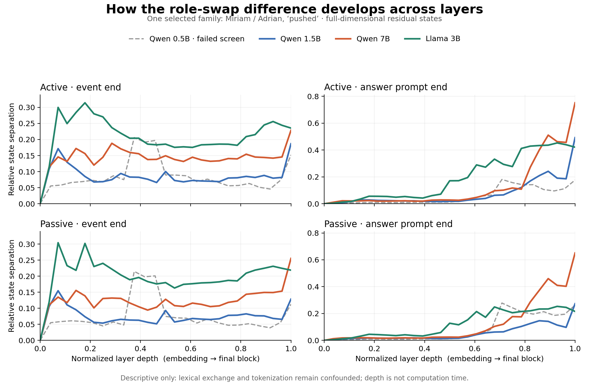

# The models' layerwise lines on the sole common competent family

17 October 2026. Observational visualization requested after the [family competence gate](GATE_REPORT.md) failed. This is a **separate descriptive extension**, not a continuation of the stopped causal comparison. The item f07 (Miriam/Adrian, *pushed*) was selected *because* it was the only family all three primary models answered correctly in all four conditions. It is therefore exposed and cannot validate a population or held-out claim. Qwen 0.5B failed this family and is drawn as a dashed diagnostic line.

The [view lock](PATH_VIEW_LOCK.json) was saved before any new state capture. For each model, I captured the embedding and every block output at the event sentence's final token (before the question) and the answer prompt's final token. I compared the A-Agent and B-Agent versions within active voice and within passive voice. At each layer the plotted quantity is `||h_A-h_B|| / mean(||h_A||,||h_B||)`. This uses all hidden coordinates; the only cross-model alignment is normalized layer depth and the common experimental condition labels. Source states, token positions, prompt strings and hashes are preserved in the per-model `PATH_VIEW_*.npz` and `PATH_VIEW_*.json` files. The [plot script](plot_path_view.py), [machine metrics](PATH_VIEW_METRICS.json) and [PDF figure](PATH_VIEW_LINES.pdf) reproduce the view.

## What the lines show

- At the **event-end site**, Llama 3B shows larger early separation than Qwen 1.5B and 7B in this item. Qwen 7B rises again at the final block. These differences are visible in both active and passive forms.
- At the **answer-prompt site**, Qwen 7B's role-swap separation grows sharply near the end, reaching 0.752 active and 0.651 passive. Qwen 1.5B reaches 0.492 active and 0.273 passive; Llama 3B rises earlier and ends at 0.421 active and 0.215 passive. Qwen 0.5B ends at 0.177 active and 0.262 passive, but its behavioral failures make a semantic reading especially inappropriate.
- Active and passive lines within each model have broadly similar shapes, but the prompts still swap both names and their positions. The resemblance might be a generic model schedule, lexical difference or answer-state effect. The figure cannot distinguish these explanations.

The plot script was technically corrected after the first render: the answer-site curves had been clipped by a shared event-site y-axis. The saved states, formula, model runs and metrics were unchanged. The final figure uses a separate vertical scale for each site, shared across active/passive rows. That axis choice is visible in the panel labels; compare **shapes** across columns, not raw vertical location.

## Scientific limit

These are **distance-vs-depth lines**, not literal computational routes or causal paths. They say that swapping the Agent produces different residual states, and that the magnitude of this difference develops differently by model and token site. They do not identify a role-binding operation, its timing, or family-dependent mechanistic equivalence. The sole common competent family and lack of lexical/position controls prevent an inferential conclusion. The failed competence gate remains the decision for this study; no hidden-state patching was done.
