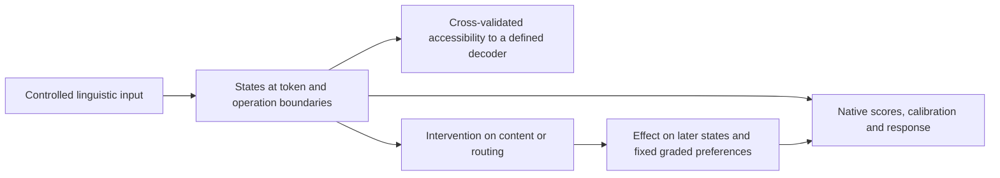

# Reconstructing linguistic processing: proposed design

**Status: proposal for review, not an inference authorization or executed experiment.** 19 October 2026. Preferred first step: saved-data analysis only. Any new interventions require separate approval and a complete frozen protocol. Existing failed gates stay closed. The 1,758-call investigation is finished.

## 1. Scientific target

Reconstruct which relationships are accessible, which influence a specified readout, which messages causally carry the effect, and which later operations are needed to use it. Do not infer functions from a line's rise or assign one function per layer. Repeated computation, distributed representation, mixed mechanisms and wrong outputs remain possible.

The deliverable would be a **linguistic computational-process map** indexed by checkpoint × lexical/construction family × controlled factor × token anchor × operation boundary. Each cell stores multiple validated quantities, their uncertainty and their missing controls. Unknown entries remain unknown.

This is a plan for measurements, not a diagram of an established model circuit. Attention, MLP and residual operations can affect every column repeatedly.

## 2. What our saved data can actually answer

The file inventory was checked on disk in SAVED_DATA_INVENTORY.json. No new probes or model readouts were fit in this review.

| Archive | Available observations | Answerable without Transformer forwards | Not recoverable from this archive |
|---|---|---|---|
| Completed graded routing |96 normal prompts;1,632 interventions;24 shams;6 validations. Full output vectors and29 residual boundaries at period/assistant end for every call | Native/calibrated discrepancy; role×query scores and raw/normalized intervention effects; development/evaluation failures; descriptive state contrasts; decoder accessibility at two anchors | Separate head/Q/K/V/MLP effects; all token positions; counterfactual messages not executed; generalization to new question types |
| Repaired Atlas continuation |64 unique main captures,2 lexical families/model; all 28 attention and MLP writes plus29 residual boundaries at declared sentence/question sites (sample 14 sites) | When grouping contrasts first become observable; same-answer context differences; contribution to a fixed external decoder before/after each write | Causal component use, fresh replication, many independent lexical families; failed behavioral gates cannot become passes |
| Component reuse pilot |Qwen development component arrays at 6 anchors; native role/voice/cleft and code-permutation outcomes | Descriptive response-format sensitivity, cancellation and write contrasts | Causal reuse; the original numerical/competence failures still limit interpretation |
| Earlier relation audit |Eight lexical families, two questions, role/voice cells, two anchors, embeddings plus28 blocks | Geometry and known copying/output predictor comparison; some additional decoder diagnostics | Clean historical Llama replication: its original pre-question invariance gate failed |
| Layer-write audit |Audited derived write differences and accounting identities | Reuse its established accounting conclusions | Attention/MLP cannot be reconstructed from whole-block differences alone |

Already answered: nonzero same-label interaction is possible; incorrect responses can coexist with structured state differences; final labels depend on readout bias; source dependence varies with checkpoint/condition; generic schedules and strong copying competitors survive. Replotting these does not create a new result.

New saved-data work worth doing: place **decoder accessibility, decoder-relative write changes and the already measured causal score effects side by side**, retaining wrong answers. This can expose a specific mismatch to investigate. It cannot create the absent intervention evidence.

### A design-level obstacle discovered here

In the present two-person binary panel, gold answer A=1 iff R=Q. Therefore R can be recovered perfectly from (A,Q). A representation of the answer together with the question and a representation of the role assignment are informationally interchangeable on this support. Conditioning a probe on both gold answer and question makes the role target deterministic. Removing one answer axis does not remove all answer preparation. A stronger probe or a new cosine cannot solve this identification problem.

Likewise, a zero role×question interaction before the question is a causal-prefix null, not evidence that the role assignment is unavailable there. The period cannot depend on a future question; it may still carry role information.

Any future broad semantic claim must add a relation variable not fixed by the current answer/question pair. Two independently reversible events, with queries about either one, provide a simple construction: change the unqueried event while holding the current answer fixed. This is a substantive design requirement, not just a matched-label analysis trick.

## 3. Measurement contracts

Let X be the complete input; R a role assignment relative to an unordered, canonically indexed name pair; Q the question demand; C the declared nuisance context; h[l,t] a captured state; a[l,t],m[l,t] the attention/MLP writes; s the final Yes-minus-No alias logsumexp. In a richer task let Y be the complete event→Agent/Patient assignment and A the answer to the current query.

| Candidate | What it genuinely measures | Same observation can arise from | Distinguishing test / required restraint |
|---|---|---|---|
| Fixed-capacity decoder of R or Y at h[l,t] | Accessibility to that trained decoder on the evaluation distribution | Surface markers, name identity, probe learning the task, current answer+Q | Hold out complete lexical families and syntax; compare lexical/order baselines and randomized labels; then interchange the candidate variable and test downstream use |
| Change in decoder loss after attention/MLP write | Change in that decoder's recoverability at the actual sequential boundary | Nonlinear recoding, scale, cancellation, probe mismatch | Patch/replace the write and rerun the unchanged suffix; decomposition alone is not causal contribution |
| Intermediate final-head or logit-lens scores | Output tendency under an external early exit/readout | Readout-coordinate mismatch, label bias, calibration, output preparation | Compare a separately trained decoder and final native output; test a matched downstream readout intervention. Early lens failure is not unavailable information |
| Final D and all four ordinal contrasts | Task-specific graded relation×query sensitivity | Syntax-aware comparison/copying; conditional output biases | Independently vary relation, surface form and answer; use novel query demands and specific interchange predictions |
| Existing closed/frozen/live effects | Effect of the specified edge-deletion policy on the final contrast | Renormalized attention, alternate routes, preexisting suffix information | Keep recipient attention routing fixed while replacing values; separately replace keys; preserve identity and neutral/neighbor controls |
| Same-answer/different-relation state difference | Context dependence beyond a single fixed answer label | Lexical/context processing or confidence-dependent answer preparation | Show relation-specific transfer to more than one downstream question, with irrelevant relations spared |
| Successful cross-voice decoding/transfer | Generalization over the particular alternation and donor protocol | Learned marker lookup, position correction, broad context transplant | Lexical and order controls plus event-specific interchange. It remains compatible with an algorithmic syntax-aware lookup |
| Closure or bypass late in depth | Sufficiency of surviving states under that intervention | Redundancy, compensatory routes, output already prepared | Test the unchanged native computation's necessity with matched removals and a demand requiring recombination; source closure alone does not prove computation has ended |
| Attention weights or gradient attribution | Routing weights or local sensitivity at a specified operating point | Correlated predictors, distributed cancellation, gradient saturation | Natural counterfactual message replacements and downstream score effects; do not equate attention mass with semantic credit |
| Native accuracy / fixed calibration | Actual next-token classification / a separate externally fixed decision rule | Verbalizer priors, unsupported output forms, calibration failures | Counterbalance response encoding and use complete generated responses in a separately approved study; never relabel calibrated output as native generation |

A simple syntax/marker copier remains a serious competitor even when every listed measurement succeeds. A learned relational causal abstraction is a statement about intervention behavior, not proof of one unique semantic algorithm. [Causal abstraction](https://arxiv.org/abs/2301.04709) supplies a relevant existing formal language.

### Information-theoretic measurements, if later approved

Define the sampling distribution before estimating information: balanced factorial R, fixed lists of lexical families, voice and Q, and a family-grouped split. C may contain the unordered entity set/verb identity, voice and question orientation, but not a full ordered sentence, role annotation, or (A,Q) that already determines R. Define binary R relative to canonical entity indices so names themselves are not the target. For a multi-event extension Y is a vector of both event bindings.

Use a fixed low-capacity probabilistic decoder g_l(R|h,C), trained only on training families, versus g_0(R|C). Report held-family mean log-score improvement:

J_l = mean[ln g_l(R_i|h_i,C_i) − ln g_0(R_i|C_i)].

This is out-of-sample predictive gain for two specified decoders, not automatically mutual information. If the experimental conditional prior is exactly known and balanced, g_0=.5 and ln2−cross-entropy(g_l) is a decoder-relative variational lower-bound expression for conditional MI at the population level. Its finite-sample estimate can be negative or exceed its population value through sampling error. Do not claim exact MI or treat fit accuracy as an entropy estimate. If C is not balanced or g_0 is estimated, report predictive gain without the lower-bound label. Fix regularization, calibration, clipping and all layer/site comparisons before fitting. Current two development families are insufficient for a reliable high-dimensional MI estimate; exploratory diagnostics must say so.

Decoder entropy H_g(R|h,C) is the decoder's uncertainty, not an established internal quantity. KL(g_l||g_[l−1]) compares those two external distributions on the same R/context; it is neither acquired information nor evidence strength, and can grow while correctness worsens. Final vocabulary KL has a different target variable (next token) and mixes formatting with content. Gallistel's event counts and Γ null are inapplicable.

For deterministic inference, the complete hidden-state graph cannot create Shannon information about labels absent from its input. A single token can acquire information by attending to other tokens; a restricted decoder can gain accessibility through computation. Those are different senses of development. Probe complexity and control tasks have established literature: [Hewitt & Liang](https://aclanthology.org/D19-1275/), [Pimentel & Cotterell](https://aclanthology.org/2021.emnlp-main.229/). Learned early readouts also predate this proposal: [Tuned Lens](https://arxiv.org/abs/2303.08112).

## 4. Three testable local mechanistic accounts

Focus first on why leaving the period route open changes a graded response around Qwen cut 14. The current masks cannot decide whether that route supplies useful content or changes routing. These are local alternatives, not mutually exclusive theories of all language processing.

| Account | Accessibility expectation | Distinct intervention prediction | Evidence that challenges it |
|---|---|---|---|
| H_V: relationship-dependent content in period values is used by the suffix | Role information may be decodable before the query and in period states; decoding alone is insufficient | Opposite-role period **value** donation, with recipient keys/attention weights preserved at the edited operation, shifts both question orientations toward donor-consistent answers; same-role cross-voice donation is much smaller | No selective value effect; only key donation works; effect tracks donor output label or syntax regardless of relationship |
| H_K: the period primarily supplies relationship-dependent addressing/gating | Role decodability can be just as strong as H_V | **Key** donation changes the role×question contrast substantially more than value donation; joint K/V may interact. Effect reflects access/competition over existing suffix content | Selective value transfer with keys fixed; no key-specific effect across lexicons/voices |
| H_S: the relevant response is mainly maintained in distributed suffix states; period-mask effects are nonspecific competition or modulation | Both period and suffix may decode well | Neither relation-directed period K nor V donation selectively reverses the response; effects are small or comparable to same-role/neighbor changes, despite ordinary knockout effects. Later suffix perturbation would be needed for a positive causal localization | A relation-specific period message redirects both conditional questions while matched controls are spared |

Mixtures, interaction-only K/V effects and construction-specific mechanisms are legitimate outcomes. Failure at one site does not falsify all possible cached relations, all query-time retrieval or all output preparation. These accounts deliberately predict different local causal responses; none is entitled to the name 'the semantic mechanism'.

Across depth, early reusable content predicts that a successful content interchange can answer multiple later demands; query-triggered source retrieval predicts demand-dependent source-message effects; output preparation predicts sensitivity to answer encoding/readout even with accessible relationships. These broad patterns may coexist. The local K/V test is one way to resolve a specific ambiguity, not a full adjudication of those global accounts.

## 5. Smallest next work: saved data first

**Preferred immediate follow-up, after review: zero Transformer forwards.** Use the completed run's normal period/answer states and the Atlas component captures. Freeze one linear probabilistic decoder specification, lexical-family splits and label controls; run no hyperparameter/site search. On the six-family panel, fit on g01/g02 and report every g03..g06 family/voice result, without calling these previously viewed cases prospectively untouched. Period Q duplicates count once. Cross-voice transfer is a separate fixed diagnostic. The tiny training sample makes a failed decoder inconclusive and a positive result exploratory.

The Atlas provides a better existing separation of the target from the current answer: within each lexical family its Agent question and answer are constant across four sentences, while complete Theme/Goal membership takes three different values. Its within-group name permutation preserves membership; crossing the and/to boundary changes it. `audit_existing_support.py` verifies this directly from both models' archived annotations, and verifies the binary-panel equivalence across all 96 input rows. This is a metadata identification check, not a new observation of model computation.

For the Atlas diagnostic, target complete Theme/Goal membership relative to canonical entity slots under the constant Agent question; compare its decoder with frame/position/lexical controls. Do not use a global constant Yes/No label as the target or equate mention-order decoding with role decoding. Split by entire lexical family in both directions (a01→a02 and a02→a01), with all four transformations grouped; count only four physical sentences per family rather than treating multiple questions, candidate entities, layers or token positions as independent examples. Include the meaning-preserving within-group permutation explicitly. There are only two families: estimates are exploratory and no cross-family significance/novel mechanism claim is defensible. A nonlinear syntax-aware decoder may solve the task itself; a positive probe still needs causal interchange.

Report decoder accessibility beside native s/D, raw labels, calibrated labels and already measured intervention response for each unit. For Atlas writes, evaluate recoverability at residual input, after attention and after MLP, respecting the actual sequential order and the recorded reconstruction error. Reuse established plots rather than generating a new gallery of cosines. Do not interpret final-head projection at intermediate layers as native evidence. Do not pool Atlas Agent labels across lexicons: family identity confounds that target.

This can distinguish a strict 'nothing recoverable when the model answers wrongly' account from accessible-but-misread information under the chosen decoder. It cannot distinguish H_V/H_K/H_S: their required K/V counterfactuals are absent. If the review's objective is decisive causal discrimination, do not present this saved-data analysis as sufficient.

## 6. Smallest new causal experiment worth proposing

**Not executed.** One checkpoint (existing local Qwen7B), fixed cut 14 and period anchor, fixed existing prompt/scorer. Two already exposed development families g01/g02 and two genuinely new lexical families declared before new outputs. Each crosses R×voice×Q:32 inputs total. Both voices retained; no competence-based case deletion. No Llama replication claim from this first local test.

For every input, propose exactly 10 conditions:

1. Native capture.
2. Source-isolated-period recipient baseline (existing frozen14 graph).
3–5. Opposite-R, same-voice donor: period V only, K only, K+V.
6. Same-R, opposite-voice donor: period V only, a meaning-preserving syntax control.
7–9. Opposite-R, same-voice donor at the preceding lexical token: V, K, K+V controls (not information-free nulls).
10. Identity period K+V replacement sham.

**320 scientific forwards +3 numerical validation forwards =323 proposed cap; no automatic extra runs.** All32 inputs receive the complete panel, even if native labels are wrong. Frozen scalar readout calibration remains separate and is never refit. No paid calls, downloads or training are required. This is a resource bound proposal, not a fully registered protocol.

### Implementation contract

Capture donor projected K/V at every changed block14..27 during a source-isolated-period run. Donor period states cannot depend on its later question; save and test that equality. Reuse donor captures across the two question orientations; do not import donor states that can reread its original sentence after14.

Replace **only the period-to-suffix contribution**, for all fixed heads and future blocks. V-only keeps recipient queries/keys and therefore the instantaneous recipient attention weights; later downstream states may change, which is the intended causal effect. K-only keeps recipient V and alters the period score plus softmax competition. Joint replacement tests their interaction. Shared GQA keys/values must not accidentally change other source-token edges or period self-updates. Operation-specific hooking must be validated against the native implementation before scientific inference.

Opposite-role same-voice donor/recipient period indices must align, including RoPE and tokenizer lengths. A cross-voice K transplant is intentionally absent because differing positions introduce a rotary-phase confound; the cross-voice V control still tests position-containing representations and is not a pure voice effect. Fix donor/recipient token alignments with AI-only annotation and an exact tokenizer manifest. Identity, unchanged-prefix, pre-cut and dense-repeat controls are mandatory. If edge-specific intervention or alignment cannot be implemented faithfully, stop before the scientific panel; do not substitute whole-state patching and retain the same claim.

### Outcomes to freeze before executing

Keep all four question scores; summarize D_B for the source-isolated baseline and D_T for each donation. For cells with D_B≥.5 and positive conditional ordinal contrasts, E_T=(D_B−D_T)/(2D_B) measures the fraction of a full sign reversal; also report unnormalized changes. Otherwise normalized E is undefined and the unit cannot support a positive signature. Never drop it or replace zero.

Proposed signatures for review: content dominance if E_V≥.25, E_V−E_K≥.25; key dominance if E_K≥.25, E_K−E_V≥.25; each additionally requires same-role V control |E|≤.10 and the corresponding neighbor effect at least.25 smaller. A suffix-dominant null requires |E_K|,|E_V|,|E_KV|≤.10 and cannot by itself prove the suffix mechanism. Ambiguous, mixed and interaction-only effects remain unclassified. Require both questions' individual donor-consistent shifts, not only positive aggregate D change; require both voices for a complete family. Exact per-question thresholds, all numerical tolerances and the full call manifest must be finalized and frozen before approval/execution. These proposed numbers are not inherited scientific constants.

Use development only to classify the prespecified candidate, never change cut, donor, prompts or score after fresh outcomes. Collect the complete fixed fresh panel even if development is mixed; call a prediction supported only if its unchanged criteria pass both voices of both fresh families. Otherwise report failure/mixture. A positive result earns a narrow content-versus-addressing dependency claim. No branch earns a unique abstract-semantic or novelty claim.

### Limits even if successful

Natural donor K/V can make hybrid states; selectivity controls reduce but do not eliminate distribution-shift explanations. Keys themselves encode content, and values can implement addresses: the intervention distinguishes their functional ports under this hook, not a universal content/address ontology. Donating all heads/blocks does not localize a single operation. A null can reflect redundant suffix information or a wrong candidate site. Whole-role transfer on this binary task remains compatible with syntax-aware copying and a cached two-answer table.

## 7. Alternatives to preserve

**A two-event causal abstraction is the stronger linguistic direction.** Independently vary both event bindings, event mention order, voice and the queried event/role. Use distinct verbs to identify events rather than relying exclusively on first/second markers. Include same-current-answer/different-unqueried-relation pairs and same-relation/different-answer demands. Predict an intervention on event1 binding should affect event1 queries and spare event2 queries, across role-preserving reordering and lexical substitution. This breaks the current binary answer/role equivalence, although a structured syntax-aware lookup remains a mechanistic competitor. It needs a separate sample, annotation audit and larger bounded design, so it is not the smallest immediate experiment.

**Component-specific preservation versus reorganization.** Once a valid transferable variable and readout are established, interchange it before/after attention and MLP boundaries, and test whether downstream recombination survives bypasses. Continued readability alone cannot establish preservation; native source closure alone cannot establish completed computation. This requires additional intervention records, not just saved write norms.

**Cross-checkpoint functional correspondence.** Compare which intervention contingencies hold, their partial order and task specificity. Separate accessibility, magnitude, local route, output mapping and relative depth; do not fit one trajectory score or silently warp time. Hold out linguistic factors when fitting any alignment. Multiple checkpoints/seeds per family would be required for a family-level law; Qwen7B versus Llama3B is currently a two-checkpoint comparison.

## 8. Prior work, claim limits and decision

Binding representations and causal edits already appear in [Dai et al.,2024](https://aclanthology.org/2024.emnlp-main.967/). [Mixing Mechanisms](https://arxiv.org/html/2510.06182v2) already tests positional, lexical and reflexive retrieval, including counterfactuals and attention knockout to distinguish pointers from retrieved content. The proposed port-specific comparison is a targeted response to our own mask ambiguity, not a claim that those distinctions are new. Availability versus use, probes, readout lenses, causal abstraction and attention intervention all have extensive precedent.

**Recommendation:** retain Gallistel's functional discipline; reject an automatic transfer of its rate equations or its inferred neural stages. Review the saved-data accessibility/readout comparison first. If new inference is later approved, test a concrete content-versus-routing ambiguity under a fixed graph. Pursue the richer two-event map only with an identification argument and genuinely independent linguistic validation. No experiment or publication claim is licensed merely because its results would be interesting.
