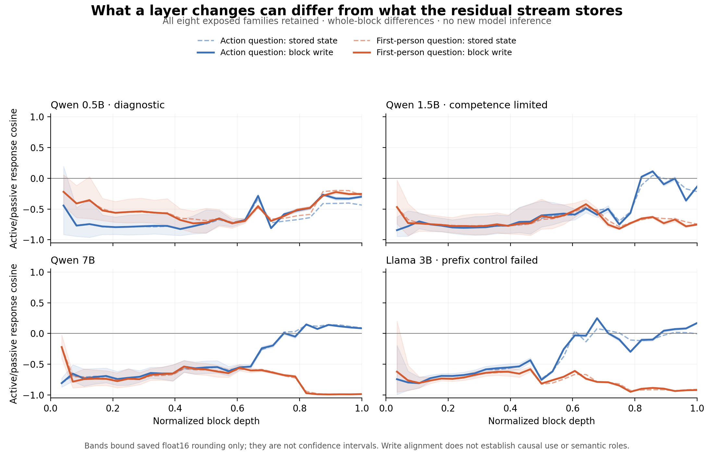

# Layers: what could be hidden, and what the saved data show

**18 October 2026. Exploratory reanalysis only.** This responds to the user's new request about hidden layer processes. It reuses the completed query-diagnostic archives without new model inference, training, download, causal patching, or changes to earlier success criteria. The previous frozen outcomes remain unchanged.

## A more precise question about layers

A residual state is an accumulated record. A block adds an attention update and an MLP update; useful information can be small relative to other stored content, distributed across token positions or components, or cancelled by another write. This motivates examining **what each block changes**, then separating attention, MLP and token routing where measurements support it. This residual-stream view is established prior work, not a new architectural hypothesis: see [Elhage et al. (2021)](https://transformer-circuits.pub/2021/framework) and [attention feature-interaction tracing (2025)](https://transformer-circuits.pub/2025/attention-qk/index.html).

There is a limit to the hypothesis “the process is hidden”: computation certainly occurs, but that alone does not imply a compact shared representation, a common layer schedule, or a discoverable universal path. We need a descriptor that predicts a specific functional effect and survives a simpler explanation.

## Complete saved-state audit

The source archives contain eight lexical families, two questions, four role/voice cells, every block output and two token sites for each of four models. They were already exposed, so the present work is exploratory. The earlier Qwen 1.5B competence limitation and Llama prefix-invariance failure are retained. No family or layer was selected for a favorable outcome.

For each voice, let `d_l = h_l(A-Agent)-h_l(B-Agent)`. The block-write contrast is `w_l = d_l-d_(l-1)`, exactly the difference between the two conditions' whole-block updates. I compared active/passive `d_l` and active/passive `w_l` using all hidden coordinates. Both questions and both saved token sites are recorded in the [3,456-row ledger](LAYER_WRITE_LEDGER.csv). Summaries use broad normalized-depth thirds, not chosen peak layers.

I also decomposed paired writes into a shared-sign component `(w_active+w_passive)/2` and a flipped-sign component `(w_active-w_passive)/2`. These are algebraic descriptors, not semantic labels. Their energies sum to the mean energy of the two writes. The code verifies that identity and that all block changes telescope back to the final contrast.

Because the source captures are float16, subtracting states can magnify rounding error. The analysis computes conservative componentwise capture-rounding bounds and propagates them into bounds on each update cosine. These concern saved-state rounding only; they do not cover weight quantization, internal execution error, sampling uncertainty or the known Llama issue. No layer is removed for falling near the rounding floor.

## Result: whole-block differences do not uncover a strong earlier invariant signal

At the answer-prompt site under the action question, Qwen 7B gives:

| Depth third | Mean stored-state cosine | Mean block-write cosine | Energy-weighted pooled write cosine |
|---|---:|---:|---:|
| early, blocks 1–9 | -0.714 | -0.711 | -0.686 |
| middle, blocks 10–18 | -0.586 | -0.578 | -0.556 |
| late, blocks 19–28 | +0.033 | +0.018 | +0.285 |

Whole-block writes remain opposed in the early and middle thirds. Late alignment is stronger when large writes receive more weight, which is a sensitivity of the summary, not independent evidence of shared semantic computation. The early and middle mean update cosines remain negative throughout the conservative saved-capture rounding bounds. This diagnostic does not support the simple idea that taking block differences alone reveals a hidden earlier common direction on these saved sites.

For completeness, the other models' early/middle/late **mean write cosines** for this same question/site are:

| Model | early | middle | late |
|---|---:|---:|---:|
| Qwen 0.5B, diagnostic | -0.735 | -0.683 | -0.453 |
| Qwen 1.5B, competence limited | -0.783 | -0.645 | -0.287 |
| Llama 3B, technical control failed | -0.707 | -0.420 | +0.002 |

All question/site results, per-layer magnitudes, shared-sign energy fractions and rounding bounds are in [LAYER_WRITE_RESULTS.json](LAYER_WRITE_RESULTS.json) and the ledger. This is not a new cross-model gate pass. The source archives, source hashes and script hash are recorded in the results.

## Why an earlier positive update would still need a causal control

The existing surface-keyed answer-copying counterexample can produce `d_active=2u+2 beta_l v` and `d_passive=-2u+2 beta_l v`, with fixed orthogonal order direction `u` and distributed answer direction `v`. Cumulative-state cosine starts near -1 and becomes positive as `beta_l` grows. Yet both block changes are `2 delta_beta_l v`, so their cosine is **+1 at every nonzero step**, including early steps. Removing the direct output axis preserves this alignment if the answer code is distributed.

The [executable calibration](write_calibration.py) verifies this exact construction. It demonstrates that even a hypothetical discovery of early aligned writes would not by itself identify a reusable semantic variable. It is a counterexample to that interpretation, not evidence that an LLM implements the toy algorithm.

## A concrete way to look for the hidden process

The useful next instrument is a **layer × token × component map**. At each declared site, record separately the incoming residual, attention write, MLP write and outgoing residual. This could distinguish a pattern that is routed between tokens from one created locally, or show cancellation between attention and MLP. The current archives cannot resolve those components, so no such finding is claimed here.

That map would need three independent experimental axes:

1. **Event relation:** who did what to whom, with voice and name order counterbalanced.
2. **Question:** Agent, Patient, first mentioned and last mentioned, so relation identity and selected person can vary independently rather than move together in every contrast.
3. **Answer coding:** the requested person can be named directly or reported through a counterbalanced label mapping. This tests output-token dependence, while acknowledging that a distributed selected-person code remains a rival.

A candidate process must then have a functional prediction: one fixed, native intervention identified on development cases should change the relation-dependent answers in the intended way across questions and output codes on untouched constructions, with same-answer, surface-order, unrelated-donor, sham and neighboring-site controls. The mapping must be fixed across those conditions; separately choosing a new mapping for each answer would remove the discriminating test. Geometric comparison should earn interpretation by predicting these effects beyond output-only and compound-key baselines.

This is a proposed measurement and validation design, not an executed new causal study, a promise of identifiability, or a claim that layers contain neat serial stages. [Causal abstraction](https://arxiv.org/abs/2301.04709) and existing [binding analyses](https://aclanthology.org/2024.emnlp-main.967/) already cover much of the methodological foundation. The possible contribution would have to be a specific reusable causal dependency or a rigorously demonstrated limit of the comparison, with independent replication.

**Decision:** continue to treat a hidden shared process as a hypothesis. The saved whole-block audit did not reveal it. The next discriminating measurement would separate routing, writes, question selection and answer coding; another distance curve or an adaptively selected layer would not establish that mechanism. No new model experiment was launched after this audit.

## Reproduce

Run `analyze_writes.py` and `write_calibration.py` with the existing NumPy/Matplotlib environment. The scripts use only local saved arrays and preserve prior outputs. Full source tensor hashes are in `LAYER_WRITE_RESULTS.json`; the PDF figure is [here](LAYER_WRITES.pdf).
