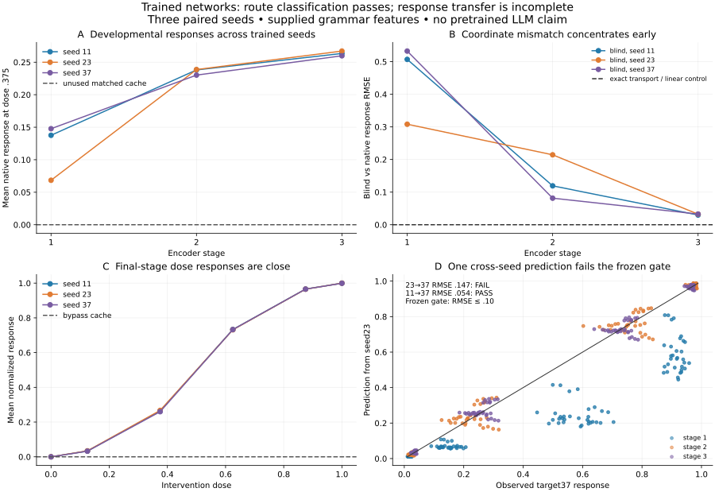

# Learned intervention transport: results and limits

**Decision: NARROW.** The blind difference-of-means intervention fit creates apparent disagreement under a known nonlinear change of hidden coordinates in all three trained seeds. Exact intervention transport removes that disagreement. The route classifier passes its small held comparison set, but the stronger cross-seed response-prediction gate **fails**: one of two same-route transfers exceeds the frozen RMSE threshold. The assay is numerically valid; robust developmental correspondence is not established.

Frozen protocol and scripts: [1304a2f376ffcb2582840b8c33b8abf2449ff4a4](https://github.com/Joel-Vazquez-Lopez/relational-transfer/commit/1304a2f376ffcb2582840b8c33b8abf2449ff4a4). One execution, no retraining, seed replacement, scoring changes or corrective held-out rerun. Earlier studies and their failed gates remain untouched.



Lines connect tested stages/doses; they are not additional sampled intermediate computations. Panels A/C average across cases for visualization; all primary prediction errors and saved outcomes retain individual cases.

## What was trained

Three independently initialized tanh encoders learn a role function from supplied grammar features. Each has a cached readout trained jointly with the encoder. A second branch in each container is trained separately on raw grammar features, bypassing that encoder. There are **six trained route instances in three paired containers**, not six independent complete model training runs. Within a seed the observed encoder states are identical across the two routes by construction; the bypass does not use them.

The task uses explicit features for mention order, voice, construction and nuisance context. Names, questions, answer options and textual realizations have a complete generated manifest. The neural network does **not** read sentence tokens. The question and answer-option factors are applied algebraically to the learned role logit. New names and templates therefore do not establish learned parsing, lexical generalization or question understanding. These are small MLPs, not Transformers or pretrained LLMs.

Role, voice, mention order, Agent/Patient question and answer-option order are factorially varied. A construction flag realizes the necessary active relative/agent-fronted passive forms; the lexical-action role annotation excludes the matrix copula in relatives. Agent-fronted passives are marked English. All 512 generated train/dev/held cases passed an independent template-regex annotation check, including first mention, roles, voice and option answer. This is machine checking of AI-authored templates, not independent human linguistic adjudication.

Each route received exactly 1,800 Adam full-batch updates; no checkpoint selection. The core run completed in 5.08 seconds on local CPU; parsing checks, reporting, replay and publication are separate. Fixed small feature tasks are inexpensive. The training objective learns the role computation; the access routes are imposed architecturally, not discovered in a natural network.

## Prerequisites and preservation

- **All six route instances passed every competence gate**, including every O-reversed natural counterfactual. No documents or models were excluded or substituted.
- Training: 256 cases per instance; development and held: 128 each. Held normal outputs: **768/768**, and held role-reversed counterfactual outputs **768/768**. Question/option combinations repeat neural inputs, so these totals are not independent linguistic evidence.
- **726/726 independent NumPy replay checks passed**, reconstructing every stored intervention logit from saved weights without importing the study evaluator. Maximum discrepancy: 3.16e-14.
- **207,360 scalar intervention logits** saved, including native, oracle and blind executions, all cases/stages/doses/coordinate variants. Many are intentional repeated controls, not independent experiments. Additional baseline and donor-control logits, normalized effects, directions, states and individual held predictions are preserved.
- 246 raw arrays, 692,928 entries, plus complete weight arrays, training traces, manifests and execution log. No pickle checkpoint is needed.
- Frozen source hashes remain unchanged. All CKA values are prospectively clamped before distance calculations; no NaNs or post-run numerical repair occurred in this study.

## 1. Equivalent native mechanism, different fitted intervention

At each recorded stage, the transformed copy executes

`u = T(h)` and then `h = T^-1(u)` before the original downstream network.

For the nonlinear control, `T(h) = sinh(2h) Q / 2`, with known exact inverse. This preserves the native task mechanism under the stated coordinate correspondence. The wrappers add operations, and arbitrary nonlinear conjugacies are not ordinary parameter symmetries of an unchanged MLP or Transformer architecture. We do not claim identical primitive operation graphs or that every interpretability method should be invariant to this transformation.

The native fitted role intervention is `I(h)=h−dose×R×d`, where d is the development difference of role-group means. The oracle applies `T ∘ I ∘ T^-1`. The blind fit instead estimates its own difference of means on transformed normal activations; it has no access to T while fitting. Nonlinear transformation and averaging/interpolation need not commute. Exact transport is therefore an algebraically guaranteed upper-bound control, not a new alignment algorithm or unexpected discovery.

### Observed errors

| Seed | Native vs oracle max absolute logit error, held nonlinear | Blind vs native normalized RMSE, all held doses | Blind vs native RMSE, four fresh interior doses |
|---|---:|---:|---:|
| 11 | 5.89e-14 | .32894 | .30123 |
| 23 | 3.46e-14 | .24557 | .21762 |
| 37 | 2.54e-14 | .33724 | .31164 |

Every seed exceeds the frozen practical-discrepancy target .05. Normal wrapped outputs, shams, native/oracle comparisons and blind orthogonal controls all pass tolerance1e-8. Thus the errors do not come from a numerically broken wrapper or a changed normal task function.

Across the 4,608 cached case×stage×fresh-dose entries, blind and native interventions produce **688 different answer identities (14.93%)**, and 1,592 normalized response differences exceed .1. This is disagreement between nominally corresponding interventions, not 688 errors on untreated sentences. These entries include repeated question/option conditions and share only three seeds; no binomial significance claim is appropriate.

### Layer dependence: descriptive, not a new mechanism claim

| Seed | Stage1 coordinate-induced RMSE | Stage2 | Stage3 |
|---|---:|---:|---:|
| 11 | .50706 | .11928 | .02976 |
| 23 | .30829 | .21444 | .03234 |
| 37 | .53259 | .08147 | .03267 |

The coordinate mismatch is substantially larger early than late in these networks. Stagewise summaries were planned; the interpretation of this pattern is exploratory. The final-stage dose-response curves are also close across seeds. Neither observation proves progressive construction of a shared linguistic mechanism: the bottleneck, simple target and common readout objective strongly constrain the task. Final answer preparation remains a competing explanation for late agreement.

## 2. Identical observed cache, different causal use

Within each seed, cached and bypass encoder trajectories are exactly identical. Cache interventions have exactly zero output effect in bypass, including the nonlinear blind intervention. Natural role-reversed donor states reverse every cached answer at all three sites; same-role, changed-voice/order donors preserve every answer identity. The independent audit checks these controls.

This validates the engineered information route, not a novel phenomenon in neural networks. It demonstrates why representation similarity alone cannot determine whether the observed representation is used. No claim that the two readouts have identical complete network trajectories is made; only their matched encoder states are identical.

## 3. Classification succeeds; individual transfer is incomplete

The three alignment procedures—same depth, CKA-derived monotone path, and development causal-profile path—selected the same diagonal paths on the primary pairs. All route decisions then used causal response disagreement. Consequently **4/4 route classifications is not a victory of a new metric over CKA**. No alignment method improved over known stage identity here.

Calibration uses source11→target23 only. Positive causal distance .08916967; negative .62616495; locked threshold .35766731. Primary held target37 results:

| Source → target route | Development causal distance | Held individual response RMSE | Frozen .1 prediction gate |
|---|---:|---:|---|
| cached11 → cached37 | .01253 | **.05442** | PASS |
| cached23 → cached37 | .10040 | **.14698** | **FAIL** |
| cached11 → bypass37 | .62616 | .59246 | Different route, as classified |
| cached23 → bypass37 | .58665 | .54434 | Different route, as classified |

The positive/negative route classifications are correct for all four primary comparisons, but those comparisons are correlated and involve only three seeds. Predicting an unused branch's zero response is easy once the route is known; its large copied-source prediction error is expected, not successful transfer.

The failed positive transfer's stage errors are [.24836,.04600,.03187]; the passing transfer's are [.05968,.06049,.04080]. Later stages look more transferable, while the stage1 failure breaks the whole-development prediction criterion. We retain the whole-development failure; restricting the success claim to selected later layers after seeing it would change the test.

Held predictions use source-model interventions on matching individual held cases as measured inputs, with a mapping fitted on development responses. They do not infer target counterfactuals from normal observations alone. Target normal development states also fit its direction, and target development interventions inform causal alignment. Patient-vs-Agent transfer is algebraic symmetry here, not learned question generalization. All 54 method/pair records, including nonprimary comparisons and self checks, are available in `PAIR_RESULTS.json`.

## What this changes in our research judgment

The measurement concern survives the transition from handwritten scalar programs to learned representations: a simple intervention fit can create large apparent differences between known coordinate-equivalent native mechanisms. That is a concrete failure mode of this fitting procedure in this declared setting.

The more ambitious claim did **not** pass: shared access routes and successful route classification were insufficient for reliable whole-development prediction across seeds. The failed .14698 transfer must remain part of the conclusion. This supports separating three claims in future work:

1. Representations contain a decodable relation.
2. A particular information route causally uses that relation.
3. Two systems have counterfactual response functions that predict one another at matched stages and contexts.

Evidence for one does not establish the next. Our current experiment directly calibrates part of 2 and tests a restricted version of 3. It does not identify the complete algorithm in either network or demonstrate a universal developmental similarity.

## Prior research and novelty

[Causal abstraction](https://arxiv.org/abs/2106.02997) already uses interchange interventions to test aligned causal variables. [IIT](https://arxiv.org/abs/2112.00826) explicitly trains neural networks to realize target causal structures. [InterpBench](https://papers.nips.cc/paper_files/paper/2024/file/a8f7d43ae092d9a5295775eb17f3f4f7-Paper-Datasets_and_Benchmarks_Track.pdf) uses semi-synthetic Transformers and stricter intervention training for evaluation. Known-route/known-algorithm calibration is therefore established, not a new contribution of this study.

[Sun & Toneva's Congruity](https://arxiv.org/abs/2603.30002) directly addresses interpretive equivalence using sampled implementations. Its intervention sampler is not reproduced here; this study establishes no superiority over it or failure of its framework. Our nonlinear stress class also differs from ordinary architecture-preserving parameter changes. A paper would require an appropriate existing-method comparison and additional learned-model settings.

The [reply in the interpretability-illusion debate](https://arxiv.org/abs/2401.12631) highlights that particular intervention-based rejection criteria can reject otherwise meaningful explanations. We similarly make a bounded claim about one fitted perturbation family, not universal invalidity of relational interpretations. No resolution of that debate follows from these results.

[Dai et al.2024](https://aclanthology.org/2024.emnlp-main.967/) identifies a low-rank binding-information subspace and performs binding edits in language models. This grammar-feature MLP study identifies no new binding mechanism, does not supersede those results, and does not remove the earlier Qwen causal-identification confounds. The observed layer pattern is not ready for a novelty claim.

## Resource use, reproduction and stopping

No paid API, pretrained inference, external annotation calls, model downloads or cloud training. Existing Python/PyTorch CPU environment only. The binary checkpoints contain NumPy arrays, with every architecture and factor code in `study.py`.

```sh
research/stronger_model_development_2026-10-15/.venv/bin/python research/learned_intervention_transport_2026-10-18/validate_cases.py
research/stronger_model_development_2026-10-15/.venv/bin/python research/learned_intervention_transport_2026-10-18/study.py --preflight
research/stronger_model_development_2026-10-15/.venv/bin/python research/learned_intervention_transport_2026-10-18/study.py --execute
research/stronger_model_development_2026-10-15/.venv/bin/python research/learned_intervention_transport_2026-10-18/audit.py
MPLCONFIGDIR=/private/tmp/learned_transport_mpl research/stronger_model_development_2026-10-15/.venv/bin/python research/learned_intervention_transport_2026-10-18/report.py
```

Reproduce in a separate copy: `--execute` requires a freeze receipt and deliberately refuses to overwrite the existing results directory. Source, protocol, annotation validation and audit were frozen before training. Reporting code was written afterward and consumes saved arrays only. `EXECUTION.log` records the single training/assay run; all original outcomes are retained.

`raw_outputs.npz`: keys contain seed/route/split/coordinate. `__logits` and `__effects` axes are case × stage × dose × [native,oracle,blind]. `__natural`: case × stage × hidden dimension. Development doses [0,.25,.5,1]; held [0,.125,.375,.625,.875,1]. `__donor_control_role_logits`: case × stage × [role-reversed,same-role-surface]. `prediction_*`: held Patient cases in manifest order × target stage × four fresh interior doses. All scores are role logits; answer-option logits are role logits × Q × L. Full case inputs and weights are saved separately.

**Stopped after this study.** No additional model training, adaptive experiment, LLM run or post-hoc restriction of the success gate followed these outcomes. Current result is a bounded methods calibration and a failed robust-transfer criterion; it is not a demonstrated publishable novel mechanism.
