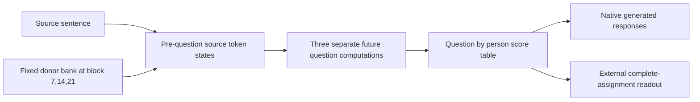
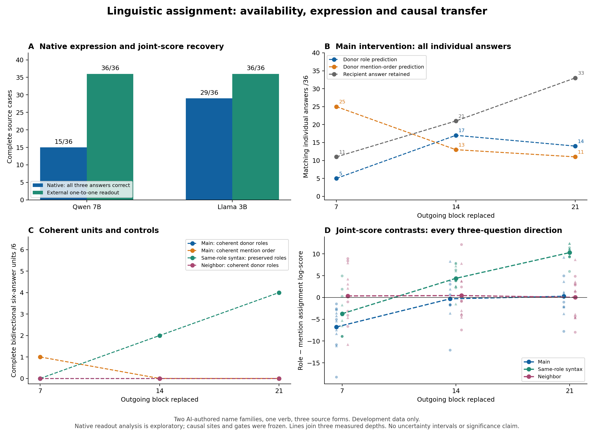

# Final stretch: completed evidence and the research decision

20 October 2026. **The bounded investigation is finished.** The useful new result concerns full-assignment recovery from joint scores;the proposed transferable participant bank failed its causal gate. No new mechanism or paper-ready novelty is established.

## What was actually completed

1. Audited earlier findings and checked primary binding,retrieval,calibration and joint-decoding literature. Existing trajectory similarities do not yet identify a linguistic computation;the24-family correctness-selection result remains a separate completed measurement finding.
2. Preserved a separately frozen Qwen attempt that stopped on critical memory pressure before scientific collection. No Qwen load was forced past that guard.
3. Collected the same108 development sentence/questions on the existing smaller Llama checkpoint. All394 forwards completed:101/108 native answers,29/36 complete cases,466 production and2,760 independent audit checks passed.
4. Found an exploratory fixed external assignment decoder recovers36/36 full assignments in both checkpoints. It improves source-case completeness from15/36 for Qwen and29/36 for Llama. Independent source parsing and five rival-cycle margins certify all72 results in224 checks. This uses three question-conditioned score vectors and an externally supplied one-to-one task constraint;it is neither native behavior nor a new decoding algorithm.
5. Executed all432 Llama causal conditions across the predeclared7/14/21 depths:1,733 forwards,2,499 production and15,436 independent checks passed. No depth supports complete native role transfer in any bidirectional six-answer unit. No evaluation case was opened and no post-failure site/model search followed.

## The central result

|Measurement|Qwen7B|Llama3B|
|---|---:|---:|
|Native individual answers|86/108|101/108|
|All three native answers correct for a source|15/36|29/36|
|Full assignment recovered by fixed external decoder|36/36|36/36|

The joint scores contain discriminating information that native independent winners fail to express on some cases. Shared candidate-only and question-only additive offsets cancel exactly in assignment comparisons. This establishes output-score recoverability on the panel,not where information resides,how it was constructed,or whether a single hidden state carries it simultaneously.

The causal depth profile provides a different result. At block7,mention-order predictions match25/36 main answers;at21,33/36 answers retain the original recipient answer. Correct switches on the24 changed-role questions are4,8,2 at blocks7,14,21,respectively. All three depths have0/6 complete bidirectional role units. Under the same external joint-score decoder,main banks produce mention-order assignments in9/12 directions at7 and recipient assignments in12/12 at21. These descriptions cannot turn the failed frozen role-transfer gate into a success.

## What the unexpected outputs teach us

Twenty-nine causal outputs are incomplete or outside both known name sets. Sixteen exactly match recipient-prefix/donor-last-subtoken splices,including `Ag Esther` and `Delia`;11 are surface-aligned. This mechanical post hoc audit exposes a serious lexical-granularity rival. A last-subtoken patch can mix name fragments and other contextual features. It does not provide a clean intervention on a semantic variable. The negative gate therefore constrains this chosen assay,not the existence of linguistic relational processing.

## A functional map that the data support

The intervention measures downstream dependence on selected token states. The two output readouts measure different behaviors. Neither identifies a layer's unique function or an attention/MLP circuit. Full29-stage residual captures are saved,but only three causal depths and selected token sites were tested. This is a coarse functional profile,not a complete internal process map or cross-model causal replication.

PanelB includes invariant questions;PanelC requires both changed roles and the preserved role in both directions. PanelD shows every three-question direction and raw composite-score contrasts. Lines connect measured depths only. Scores from different question prompts are summed as an external composite criterion,not interpreted as a native joint posterior over assignments.

## Research and paper decision

**Primary causal decision:NO-GO for the chosen participant-bank candidate.** There is no qualifying depth,no held-out mechanism confirmation,and no claim that all richer copying/parser/mixture accounts were excluded.

**Strongest defensible research direction:**an empirical measurement study of how native answering,jointly recoverable relational information,and coherent causal transfer come apart. The prior24-family confirmation already shows readout-dependent construction admission can change a cross-checkpoint intervention comparison. The new full-assignment analysis extends the observational distinction beyond the binary two-role aliasing case;the controlled causal failures demonstrate why decoding success must not be treated as transferable use.

This could support a focused thesis chapter or a candidate measurement paper,but publication readiness is not established. The current three-role evidence has only two authored name triples,one verb,partly family-confounded forms,exposed development data and one4-bit checkpoint per family. Maximum-weight matching,calibration,binding edits and retrieval transitions already have direct precedents. A claimed new method,universal mechanism or unprecedented phenomenon would overstate these results.

If the project resumes,the smallest scientifically motivated design change is lexical-granularity control:verify single-token participant identities or compare whole-name-span and last-subtoken interventions under prospectively matched constructions. That is a proposal for review,not an additional experiment run here. The existing t03/t04 families stay untouched.

## Reviewable artifacts

- `research/three_role_llama_native_2026-10-20/`:all native outcomes,eligibility failures,raw archives and independent replay.
- `research/binding_assignment_readout_2026-10-20/`:all source matrices,six assignment scores,224-check independent cycle certificate,scope and prior-work boundaries.
- `research/three_role_llama_causal_depth_map_2026-10-20/`:frozen protocol,every causal answer,all controls,15,436-check audit,structured-score descriptions,token-fragment audit and exact-byte raw restoration.
- `research/three_role_causal_depth_map_2026-10-20/`:preserved Qwen critical-pressure stop and recovered exposed reference,with no scientific result.
- `research/competence_selection_confirmation_2026-10-19/`:the earlier24-family prospective measurement result;not new inference in this stretch.

No paid API,model download,training,unrelated app closure or deletion of unique work occurred. The fresh completed Llama work totals2,127 forwards. The one fresh Qwen attempt produced only a recovered exposed-reference payload. One inherited collection metadata field is explicitly corrected in METADATA_CORRECTION.json;the frozen sources and original record remain intact.
