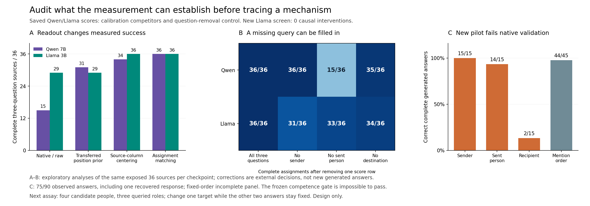

# Reformulation audit: distinguish relational evidence, salience and answer completion

20 October 2026. **New causal pilot: INCONCLUSIVE_COMPETENCE; stopped before interventions.** The useful outcome of this stretch is a narrower interpretation of our earlier perfect assignment scores and a concrete way to remove one identifiability problem. A publishable novel mechanism is not established.

## Findings that change the research direction

1. **A simple transferred surface-position correction explains much of Qwen's earlier readout gain.** Estimated from the other lexical triple, it changes independent candidate-score decisions from86/108 to103/108 correct and complete sources from15/36 to31/36, rescuing17 answers and damaging0. It uses no gold answers to estimate the correction. These are external decisions on previously exposed scores, not new generations or a prospective replication.
2. **The perfect assignment score can conceal a missing query.** Qwen still recovers36/36 complete assignments after the sender-question score row is removed entirely. With three people and three exhaustively assigned roles, the other two answers can determine the third by elimination. This materially limits a claim of separately recoverable information for all three roles.
3. **Our new matched-demand question formulation fails native validation.** Of90 observed responses, including one separately recovered response,75 are correct. Sender15/15; sent person14/15; recipient2/15; mention order44/45. We stopped when the frozen competence thresholds became impossible. No causal intervention or primary depth contrast was collected.

These findings favor studying **which relational distinctions are actually needed and accessible to a readout**, before interpreting another trajectory or composite decoder as evidence of a computational mechanism.

## 1. Saved-data calibration competitors

The old panel has36 sources per checkpoint: two lexical triples, six assignments and three constructions, with three role questions per source. Each score is the previously saved leading-space full-name path log probability, excluding EOS and alternative whitespace. It is not a posterior over interpretations. Native full-generation correctness and the raw candidate-score winner coincide on this old panel.

|External decision rule|Qwen answers /108|Qwen complete sources /36|Llama answers /108|Llama complete sources /36|
|---|---:|---:|---:|---:|
|Native / raw independent winner|86|15|101|29|
|Other-form lexical-name correction|86|15|105|33|
|Other-lexical-set surface-position correction|103|31|101|29|
|Within-source three-question column centering|106|34|108|36|
|Constrained complete-assignment decoder|108*|36|108*|36|

*The last row gives answers implied by one complete assignment, not independent question decisions or native generations.

For the lexical correction, average each candidate's log score across all questions and the other two constructions of that same name set. For the surface correction, average log scores by mention position across all questions and all six permutations of the other name set in the same construction. Subtract the resulting bias with fixed weight1 before independently choosing a candidate for each question. The two lexical sets are disjoint in that calculation; the researcher had already seen all underlying outcomes. No gold labels, tuned weights, chosen thresholds or new model calls enter estimation.

The surface correction's improvement in Qwen appears in both lexical directions and all three constructions. Llama has one rescued and one newly damaged answer, so its net surface-correction gain is zero. A lexical correction gives Qwen two rescues and two harms; Llama five rescues and one harm. These differences concern these two checkpoints, not a demonstrated property of model families.

Within-source centering subtracts each candidate's mean over the three questions for that same source. It rescues20 of Qwen's22 errors and all7 Llama errors without new harms. It uses all three test-question score rows and the balanced role panel; it is not independent single-question competence. Every calibration here is a column offset and therefore preserves all six exhaustive-assignment score gaps algebraically. Agreement with the old perfect assignment score is not a new independent confirmation.

**Supported interpretation:** some measured failures on this panel are compatible with question-independent candidate preferences obscuring useful question–candidate differences. **Unsupported interpretations:** an internal calibration module, a native matching algorithm, causal salience suppression, all three relations being independently available, or a cross-model shared process. A syntax-aware template parser and context-dependent answer preparation remain competitors.

`calibration_rivals.py` preserves every corrected answer, margin, training-source identity and bias vector. `audit_calibration.py` independently reconstructs estimates, verifies lexical/source splits and predictions, and checks assignment-gap invariance:1,154 checks pass. All analyses are explicitly post hoc.

## 2. The stronger control: remove a question

We recomputed exhaustive assignment scores after setting aside each query row, keeping the same positive-margin rule1e−8. This removes a score input from an external decoder, not a component from an LLM.

|Score rows supplied|Qwen complete /36|Llama complete /36|
|---|---:|---:|
|All three|36|36|
|No sender question|36|31|
|No sent-person question|15|33|
|No destination question|35|34|

The empirical36/36 result remains correct. Its interpretation must narrow: **the three-query score table, together with the supplied one-to-one constraint, supports the correct complete assignment.** It does not establish that every queried relation supplied separately necessary information. Qwen's sender row is unnecessary for complete recovery on all36 cases. That is a property of this decoder and panel, not proof that the model ignores sender information. An independent pure-Python enumeration verifies every old-panel lesion and margin in434 checks.

The new observed panel makes the issue concrete. Among its15 fully observed sources, native role answers are31/45 correct and only2/15 recipient answers are correct. Yet the composite decoder gets15/15 assignments right. Source-column centering gives41/45 role decisions. The ordinal panel goes44/45 native to45/45 centered and15/15 complete assignments. These are descriptive saved-data checks after the failed screen; they do not repair its frozen gate.

There is an elementary remedy to one part of the problem: use more candidate people than queried roles. With three queried roles and four candidates, zeroing one row leaves at least two unused candidates for it, so complete assignment has a tie. With three candidates, only one remains and elimination can give a unique answer despite a completely uninformative query. `nonexhaustive_certificate.py` gives the proof, an explicit3×3/3×4 counterexample and300 finite random zero-row checks. This is an identifiability certificate for an external measurement, not a neural finding or mathematical novelty claim.

Non-exhaustive decoding is not sufficient by itself: shared rejection of a distractor, lexical copying and parser-based retrieval can still assist it. The essential next control is to change **one queried role while the other two queried answers remain fixed**, as described in `NEXT_DESIGN.md`.

## 3. New native screen and stop record

The matched-demand protocol and complete inputs/code were committed and independently verified before inference at **0d7008a42442bd3bc3791ad636b3f2b855498169**. It specified144 native prompts,432 scientific hybrid generations, cuts7/14/21 with14 primary, complete single-token names, exact five-token questions, full-prefix/suffix state recombination and240 endpoint/identity/joint-swap controls. Source and question lengths are80/81 tokens by construction; paired demands have identical source, correct name and answer-readout position.

The frozen scientific requirements included at least95% correct native first tokens and90% correct complete native responses. At89 controller-completed responses,74 were correct and15 wrong. Even a perfect remainder could yield only129/144; the requirements need at least137 and130 respectively. We sent SIGINT to our own controller before any intervention.

**Scheduling deviation:** the written protocol described collecting all144 native cases and all fixed hybrids, including native failures, and stopping on failed prerequisites. We enforced the competence prerequisite early rather than completing an already invalid causal assay. This early truncation was decided after native outcomes. It does not change the question, prompts, score, hypotheses, thresholds or intervention sites; every frozen file remains byte-identical. It must not be represented as a fully executed preregistered experiment.

The worker finished one in-flight continuation while the controller was interrupted. Its raw189th payload confirms a correct90th response and EOS; it is retained in `RECOVERED_FORWARD.json`, not inserted into the original journals. Thus the full observed record is75/90 answers,15 complete six-question sources,2 fully correct sources and54 unexecuted prompts. The controller journals contain89 answers and188 forward completions;189 completed raw payloads are preserved. The stop record and interrupted traceback remain intact.

The13 recipient errors, one sent-person error and one ordinal error are all complete source-name outputs. They are not truncations or fragment mixtures. “Who is the recipient?” is particularly unsuccessful here, but comparisons with the older panel also change names, instructions and question wording, so this is not an isolated causal estimate of wording. The AI-only source annotations are template-checked; `recipient` can evoke a learned sending schema that does not match our intended destination-person role. We should validate the actual question task rather than treating a convenient metalinguistic label as equivalent to the old grammatical question.

The pilot does not adjudicate generic handoff versus prolonged role dependence. The primary contrast is **unmeasured**, not zero. It is not a new negative causal result about linguistic representations. No repaired prompts, new site, extra model or adaptive inference follows.

## 4. What the paper direction can credibly become

The preferred research question is: **When do output preferences and externally supplied answer constraints make us mismeasure access to a linguistic relationship?** This keeps linguistic processing central and gives the observatory a falsifiable measurement target.

The existing prospective24-family competence-selection confirmation is a stronger replication base than these tiny exploratory panels. It already shows that admission/readout choices can alter construction retention and checkpoint comparisons. The present audit supplies two concrete competitors: transferred surface preference and inferential completion of an unqueried score row. None of these external measurements identifies how attention or MLPs implement a relation.

`NEXT_DESIGN.md` specifies the smallest useful native extension: two new four-name sets, active/passive forms, two distractor orders, a base plus three role-isolated counterparts, and three previously validated grammatical questions—96 native responses. It is a design, not another run. Native competence must pass before any causal follow-up. Single-token identities, all four candidates, full outputs, failure counts and question-row necessity would be preserved. The old t03/t04 evaluation families remain untouched.

Later, a valid role-isolated assay could support complete-state source/question recombination or component interventions. The measurement must distinguish a changing target from the invariant answers, source copying and output preparation. Depth curves alone cannot supply that distinction. The goal remains reconstruction of linguistic computation, with a more defensible assay at its foundation.

## 5. Prior work and limits

[Batch Calibration](https://research.google/pubs/batch-calibration-rethinking-calibration-for-in-context-learning-and-prompt-engineering/) already studies prompt bias and score correction. [BERT Is Not The Count](https://homepages.inf.ed.ac.uk/scohen/eacl23match.pdf) uses global matching of mathematical statements and proofs, a methodological precedent from a different task. [Hewitt and Liang](https://aclanthology.org/D19-1275/) motivate controls on what a decoder/probe contributes. Our calibration gains, global matching and general availability-versus-measurement distinction are not new methods.

[Dai et al.(2024)](https://aclanthology.org/2024.emnlp-main.967/) identify binding-related subspaces and edit representations. This stretch supplies no comparable positive subspace intervention and neither supersedes nor refutes their mechanism. [Feng and Steinhardt](https://proceedings.iclr.cc/paper_files/paper/2024/hash/9d1b7fc578c0d2d6431fc26d736ecaf3-Abstract-Conference.html) and [Mixing Mechanisms](https://arxiv.org/html/2510.06182v2) remain close binding precedents. [Language Models Use Lookbacks to Track Beliefs](https://arxiv.org/html/2505.14685v3) already patches source, subsequent question/answer states and both jointly. [SCIT](https://arxiv.org/html/2608.27265v1) tests cache carrier sufficiency and controls in latent reasoning. A generic source/suffix handoff would not establish novelty.

Only two old lexical triples, one verb, fixed templates and one quantized checkpoint per family support the saved-data claims. The new observed sample is incomplete and fixed-order, so75/90 is not an unbiased accuracy estimate. No population significance test is reported. The elementary non-exhaustive fix must be compared with existing evaluations before any priority claim. We have a sharper experimental target and an audit result; we do not yet have a demonstrated publishable novel mechanism.

## 6. Resources, verification and preservation

This stretch uses189 completed local Llama forwards across6 workers, no Qwen, paid API, training or download. All171 recorded production controls pass; the independent stop auditor passes1,524 checks, including every frozen-file hash, every journaled raw hash, unconstrained generated tokens/EOS, candidate scores, future-question source invariance and recovered continuation equivalence. Wrapper controls passed. Counterfactual region controls were never reached and are not claimed validated. MLX peak1.991GiB, maximum recorded swap2,531.88MiB, minimum predispatch free disk11.276GiB; resource guards stayed satisfied.

All189 original NPZ payloads remain local. The exact-byte compressed-member archive has232,294,400 bytes of shards for281,878,123 original bytes. Every original was reconstructed and compared; every bundled chunk was verified. The standard-library restore script has a five-file smoke receipt. No weights are bundled. Frozen sources, all inputs, AI annotations, partial journals, stop/error record, orphan recovery, calibration/row-lesion ledgers, proof certificate, limitations and figure are preserved together. Raw files are restored with `restore_payloads.py --destination DIRECTORY`; analysis uses the existing local virtual environment. Do not rerun `run.py` or overwrite this attempt.
