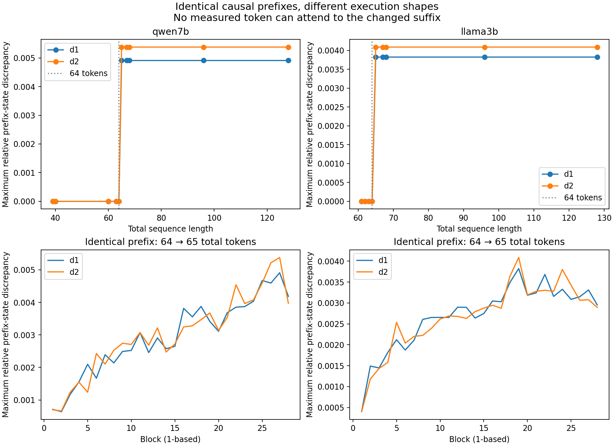

# Prefix shape audit — 18 October 2026

**Question:** Was the pre-question invariance failure caused by future question content, run-to-run noise, or execution shape?

**Bounded Qwen shape explanation: True.** This is a new diagnostic audit on exposed prompts; every earlier scientific gate and failure remains unchanged. Zero semantic interventions were run.

## Complete results

| Model | Family | Across lengths | Different suffix, same length | Exact repeat | Real questions, native shape | Real questions, padded shape |
|---|---|---:|---:|---:|---:|---:|
| qwen7b | d1 | 0.004911417 | 0 | 0 | 0.004911417 | 0 |
| qwen7b | d2 | 0.005379803 | 0 | 0 | 0.005379803 | 0 |
| llama3b | d1 | 0.00382319 | 0 | 0 | untested | untested |
| llama3b | d2 | 0.004088158 | 0 | 0 | untested | untested |

Values are maximum relative L2 discrepancies across all 28 blocks, four components and six sites. Full absolute norms, coordinate errors, cosines and every row are retained. Prefix tokens and positions are identical; suffixes are numerical controls rather than grammatical tasks. Artificial suffix continuations were never scored as linguistic answers.

Both models and both exposed families produced exactly two bit-identical prefix-tensor classes across the tested lengths: lengths up to and including 64, and lengths 65 and above. SHAPE_CLASSES.json records every length. The lower figure panels show the observed 64-to-65 discontinuity; this is a descriptive boundary localization after the fixed sweep, not an extra experiment or a changed success criterion.

## Isolating a first operation

| Model | Embedding | Input RMSNorm | Native Q projection | Q applied row by row | Same quantized Q weights, float32 matmul |
|---|---:|---:|---:|---:|---:|
| qwen7b | 0 | 0 | 1.219072e-05 | 0 | 4.236174e-07 |
| llama3b | 0 | 0 | 3.595956e-05 | 0 | 7.647691e-07 |

These isolated operations use the same prefix vectors and model weights. A shape-dependent native Q result, together with invariant embeddings/RMSNorm and invariant rowwise Q, localizes at least one source to projection execution. It does not by itself establish the exact Metal kernel, explain every downstream discrepancy or rule out additional attention effects. Float32 here means a temporary dequantized Q matrix from the existing 4-bit model, not original full-precision weights.

## What this changes

Fixed-shape extraction is a justified measurement control when its equal-shape null passes. Padding is appended after the whole prompt, where it cannot causally affect measured prefix tokens in exact arithmetic. Equal-shape agreement is a control on this backend and fixture, not a proof of hardware-independent numerical equivalence or of valid language answering on padded prompts. The reusable capture helper standardizes prefix extraction to a declared total length and reports provenance; it does not repair model competence or prove that activation transport works.

The earlier 161/192 code-answer result remains a competence failure. A technical cause for another failed prerequisite does not supply missing held-out semantic evidence. No old tolerance was raised and no semantic experiment was rerun. The two exposed families and local device/runtime cannot support a population statement or general claims about all LLMs.

A separately marked post hoc scale check compares identical-prefix drift (63 versus 67 tokens) with the already exposed active/passive role contrast. EXPLORATORY_SCALE_COMPARISON.json reports all family summaries. Small numerical differences must not be called the cause of large linguistic effects without a measured scale comparison.

**Correction to interpretation of the earlier component map:** at person A in the same-order active/passive contrast, both sentences have an identical causal prefix through that name. In both exposed families, the complete 28-block × four-component role-contrast tensor at that site is reproduced exactly by the shape-only null (zero unexplained coordinate difference). This channel is therefore entirely numerical in these saved fixtures; it cannot encode the later syntactic role assignment. This is a post hoc exact-data check, not a prospective population result. At the final sentence-period outgoing state, the null contrast is only 1.60% and 1.13% of the role-contrast norm in d1/d2 respectively, so the finding does not erase the full sentence-level contrast or explain all previous failures.

The tagged backend source supplies a dispatch explanation consistent with the observed boundary; see INFERENCE_KERNEL_SOURCE.md. The first Q projection already changes despite identical embeddings and input-normalized vectors. This isolates a numerical source without treating a source-code calculation as a direct GPU kernel trace.

## Prior work and novelty

[Thinking Machines Lab (2025)](https://thinkingmachines.ai/blog/defeating-nondeterminism-in-llm-inference/) already explains how shape-dependent reductions can produce different inference results despite run-to-run deterministic kernels. The present experiment is a local diagnostic application, not discovery of that general phenomenon. [Zhang and Nanda (2023/2024)](https://arxiv.org/abs/2309.16042) already show that patching methodology and metrics change interpretability conclusions.

[Ding et al. (2021)](https://arxiv.org/abs/2108.01661) and [ReSi (ICLR 2025)](https://proceedings.iclr.cc/paper_files/paper/2025/hash/2eef1f75516b0cfd3e944345e5f88c08-Abstract-Conference.html) already argue for grounded tests of representation similarity. [DSA](https://arxiv.org/abs/2306.10168) and [InputDSA](https://openreview.net/forum?id=2FrAvRz1E7) already compare dynamical structure and separate input effects. [Causality ≠ Invariance (2026)](https://arxiv.org/abs/2602.22424) reports that causal task vectors need not be format invariant. [Dai et al. (2024)](https://aclanthology.org/2024.emnlp-main.967/) already shows binding-related causal edits. A new similarity name or another editable vector would not establish novelty.

## Reproduction and preservation

Use the existing local MLX environment. Run each model in its own process with `python run.py qwen7b` and `python run.py llama3b`; each refuses a second start. Then run `python analyze.py`. No downloads or paid APIs. Exact duplicate tensor arrays are deduplicated by SHA256; every condition records its archive key and original input IDs. Full local tensor archives and source hashes are in the manifest. Scripts, complete raw metric outputs, figures and report are preserved on the existing research branch and linked to Issue #33. Verbose RAW JSON and CSV ledgers are committed as lossless .gz files, with decompressed originals retained locally and both checksums listed.
