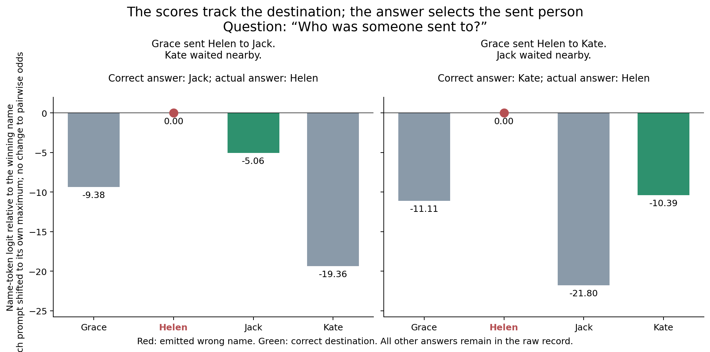
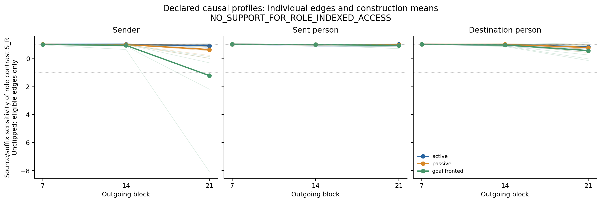

# Relational response survives wrong answers; role-specific developmental prediction fails

20 October 2026. **Complete, independently audited, and stopped.**

## Decision

**Frozen primary decision: `NO_SUPPORT_FOR_ROLE_INDEXED_ACCESS`.** The native graded-response and numerical/sham prerequisites passed, making this an interpretable failure of the declared predictive hypothesis. The generic depth predictor performed better overall than the role predictor. No criterion was changed to turn that outcome into a success.

**Broader claim: NARROW.** We observe query-dependent relational output responses and causal source-region steering in this participant-identity assay. We do not identify a distinct event-selection mechanism, reusable semantic-role developmental law or novel internal algorithm. The earlier two-event event-selection NO-GO remains intact.

## The useful observation

Qwen returns the wrong person on many destination questions while its native logits retain a strong response to the changed destination. This does not use our earlier exhaustive assignment decoder or recover a missing answer by elimination.

For the first chronological active destination-swap pair:

| | Source A | Source B |
|---|---|---|
|Passage|Grace sent Helen to Jack. Kate waited nearby.|Grace sent Helen to Kate. Jack waited nearby.|
|Correct destination|Jack|Kate|
|Actual generated answer|Helen|Helen|
|Kate minus Jack logit|−14.296875|+11.4140625|

Across **all four name rotations** of this construction/question set, the model emits the sent person in both endpoints, but its new-versus-old destination preference flips to favor the correct member of that pair. Direct changes are 25.7109, 27.9688, 28.9453 and 23.9258 logits. Query-selective interactions R are 20.9297, 23.3359, 24.6855 and 17.4727. These are descriptive full-panel examples, not another confirmatory test or a new successful answer rule.

The interpretation is precise: a relation-dependent **relative output preference** coexists with a wrong winning answer. This is not proof of an independently accessible complete representation for every question, correct native behavior, or hidden knowledge unavailable at the output. Syntax-aware retrieval and answer competition remain sufficient alternatives.



## 1. Design and chronology

The preceding Llama screen stopped at its original hard-competence prerequisite: 166/288 correct answers and 21/96 complete source cases. No Llama causal interventions were run. An explicitly post hoc triple contrast was positive in 62/72 isolated changes. That exposed finding motivated a prospective Qwen graded-response question; it did not repair the Llama gate.

Qwen's protocol, inputs, analysis and controls were frozen at **878c323110706c588f214ef71a98ef4893c4116f**. A mechanical EOS configuration error stopped the first attempt after five forwards, before a complete native answer. The original scripts, scalar EOS inputs, raw arrays, error and receipt remain in `technical_attempt_01/`. One new scientific first-token vector had been saved but not inspected. Converting the scalar EOS ID to the intended singleton list was frozen at **7427cd818eb7b86e7abdb35db7abb4c8de7bb134**; the prior five calls count toward the original budget. `TECHNICAL_AMENDMENT.json` records this exception. No prompt, token sequence, weight, score meaning, hypothesis, intervention or threshold changed.

The study uses the existing local Qwen2.5-7B-Instruct4bit checkpoint, two four-name sets, four cyclic rotations and active/passive/goal-fronted constructions. Every paired source exchanges one role participant with the irrelevant fourth person while preserving the other two queried answers and the name multiset. The fourth person is always last. Question paraphrases vary together with name set. AI-only authored annotations are independently template parsed; no human/corpus validation is claimed. Roles are sender, sent person and destination person, rather than an assumed universal Agent/Patient taxonomy.

There are 288 primary native answers from 96 three-question sources, plus 72 native sham-source answers. The 72 role-isolated edges share bases and are dependent. All names occupy one token. Full unconstrained greedy responses include EOS, with a four-decision cap and whitespace-strip scoring only. All native outputs were collected before intervention eligibility was calculated.

For candidate old/new names a/b, let m_q(X)=logit_X(b)−logit_X(a), and C_r(m)=m_r−mean of the other two queries. R=C_r(m(B))−C_r(m(A)). This standard factorial interaction cancels stated shared candidate/query offsets; it is an analyst's statistic across separate prompts. The eligibility rule also requires a direct target-query increase, format validity and fixed minimum margins. See `PROTOCOL_GRADED.md`, `METHOD_IN_PLAIN_LANGUAGE.md` and `MEASUREMENT_LIMITS.md`.

At cuts 7/14/21, complete source/suffix banks are recombined as BA=(P_B,Q_A) and AB=(P_A,Q_B). The source region ends at the final passage period; subsequent question/assistant states can already carry source information. The normalized response is S_R=[C_r(m_BA)−C_r(m_AB)]/R, without clipping. All three queries are measured for every edge/hybrid/cut: **1,296 next-token measurements**. All 432 cut14 hybrids and 72 prefix-sham responses are generated fully; cuts7/21 are next-token only. All29 native readout states and five complete prompt banks are saved.

## 2. Every native outcome, including failures

|Checkpoint|Primary correct answers /288|Complete three-question sources /96|Positive query-selective response|
|---|---:|---:|---:|
|Llama3.2-3B, exposed discovery|166|21|62/72 exploratory R>0|
|Qwen2.5-7B, prospective counterpart|239|47|71/72 both R>0 and direct response>0|

The Llama and Qwen positive counts have explicitly different rules; Qwen adds the direct-response guard. They are not a clean matched two-model causal replication. Neither column is a population significance test.

Qwen has 96/96 sender answers, 92/96 sent-person answers and 51/96 destination answers correct. All 288 primary responses have the required complete one-token-name format. Sham-source native accuracy is 61/72. Every role×form×name-set cell has at least three eligible rotations; 71/72 edges are eligible. The single excluded edge is `p02_r3_goal_fronted_role0`, retained in all raw measurements.

|Name/question set|Active /48|Passive /48|Goal-fronted /48|
|---|---:|---:|---:|
|p01|32|48|43|
|p02|34|37|45|

The **49 primary errors** are fully accounted for: 44 destination→sent-person substitutions, one destination→sender substitution, and four sent-person→sender substitutions. No wrong answer is repaired or relabeled. Complete source outcomes are separately recorded, including all 49 incomplete sources. `ERROR_SUMMARY.json`, `NATIVE_SUMMARY.json` and `NATIVE.jsonl` retain every failure.

## 3. Technical and sham gates

- All **3,428** main production checks pass; the independent saved-data auditor passes **40,100** checks, including complete vocabulary vectors, annotations, token/prompt equality, realized patch states, unchanged generated/pad tails, source-prefix future-question invariance, restart/wrapper/repeat equivalence, continuation invariance and independently recomputed predictors/decisions.
- All72 forced endpoint and108 intermediate identity/joint-donor controls pass before scientific interventions. Numerical tolerance remains ≤.05, with exact hashes where declared.
- All432 cut14 and72 sham generations terminate with a known source name. All864 secondary measurements have a name as their first token; they are **not** full-answer observations.
- All71 eligible sham contrasts satisfy |R_sham|/R≤.25. Conditional on both native sham endpoints being correct, 61/61 sham generations preserve the correct answer. The other native sham failures remain reported.
- On unchanged-role cut14 answers whose two native endpoints are correct, 233/236 remain correct. This conditional count is not 233/288; the 52 native-incompetent cases are retained separately.

## 4. The frozen developmental prediction fails

Predictions are fit on the other name/question set's other two constructions and evaluated on each held-out set/construction, separately at each cut. All eligible points remain; six folds cover213 dependent edge×depth measurements. The role, surface-position and generic predictors are training-group means. The nuisance rival is the fixed per-cut ridge model of native scores, candidate entropy and token distances. No fitted representation alignment or hyperparameter search is used.

|Predictor|Pooled held-out MSE; lower is better|
|---|---:|
|Generic depth schedule|**0.504571**|
|Queried role|0.570698|
|Surface mention position|0.582356|
|Native-output/position ridge|0.719906|

The role predictor wins against all rivals in only **3/6 folds**, rather than the required6/6, and fails the required25% pooled improvement over the best rival. Within-cut residual SD is0.662075, so a lack of measurable variation is not the explanation. The frozen conclusion is **NO_SUPPORT_FOR_ROLE_INDEXED_ACCESS**, not a new successful semantic stage account.

|Held-out set/form|Role MSE|Position|Generic|Nuisance|Role beats every rival?|
|---|---:|---:|---:|---:|---|
|p01 active|0.437422|0.401620|0.172302|0.890602|No|
|p01 passive|0.295484|0.276745|0.114130|0.299070|No|
|p01 goal-fronted|0.067441|0.113366|0.088678|0.133750|Yes|
|p02 active|0.027680|0.040758|0.019794|0.107171|No|
|p02 passive|0.021420|0.048924|0.034393|0.124263|Yes|
|p02 goal-fronted|2.756927|2.797302|2.788453|2.950457|Yes|

This does not prove every case follows a generic schedule. It says that role identity did not supply the promised held-out predictive advantage over the tested alternatives. The small fixed nuisance model is not every possible output-based explanation.

## 5. What source steering actually did

At14, source-consistent changed-role answers occur on **117/144** hybrid questions; suffix-consistent changed-role answers occur on0/144. The remaining27 answers match neither prediction. Full three-query source-consistent hybrids are **69/144**:34/72 BA and35/72 AB. Among the32 edges whose six native endpoint answers are all correct, the corresponding complete-hybrid count is59/64. These are dependent conditional descriptions, not independent replications or perfect coherent role transfer.

|Cut|Eligible edges|Mean S_R|Median S_R|Full observed range|
|---|---:|---:|---:|---|
|7|71|0.996098|0.996930|0.947512 to1.010738|
|14|71|0.971030|0.992714|0.622586 to1.048256|
|21|71|0.613180|0.937827|−8.092252 to1.115548|

Most normalized responses remain source-dominated at these sampled cuts. The late mean and median diverge; the extreme `p02_r0_goal_fronted_role0` has native denominator4.297852 and hybrid numerator−34.779297. Its−8.092252 response remains in every fit and plot. No outlier removal, clipped ratio, substitute statistic or new threshold follows. An attractive mean role curve is not enough to establish a stable developmental law.

All generated intervention answers are complete known names. That does not make wrong answers successes. `ANSWER_LEDGER.csv`, `HYBRIDS.jsonl`, the complete-hybrid records, `SHAM_RESULTS.jsonl` and `RESULTS.json` preserve both correct and incorrect outcomes. All individual three-query vectors accompany the joint contrast.



## 6. What this adds, and prior-work limits

The useful project-level advance is a role-isolated assay in which relational output sensitivity, native answer choice and causal source steering are measured separately, with a genuine completed negative predictive test. The earlier exhaustive-assignment confound is avoided for the changed role; a pure query-independent name copier yields R=0. A syntax-aware copier, query-specific answer table or distributed output preparation can still produce the observations.

[Dai et al.(2024)](https://aclanthology.org/2024.emnlp-main.967/) already identifies and edits binding-related subspaces; these full-region interventions do not identify an equivalent mechanism. [Aljaafari et al.(2026)](https://aclanthology.org/2026.findings-acl.1964/) already studies role-conditioned continuation circuits; our same-type participant-identity question is distinct, without replicating or refuting their circuits. [Villuri et al.(2026)](https://arxiv.org/html/2609.04582v1) directly precedes broad claims about useful output margins behind wrong answers and output-based competitors to probes. [Agarwal(2026)](https://arxiv.org/html/2609.17537v1) already distinguishes information availability from when it controls generation. Source/question/joint donation also has established precedents. See `LITERATURE_SCOPE.md` and `LITERATURE_FOLLOWUP.md`.

No novelty is inferred from this result alone. The strongest manuscript direction remains a controlled measurement study: how output preferences, external completion constraints and competence-based selection alter what a relational interpretability experiment appears to show. `EVIDENCE_REVIEW.md` connects the completed prospective24-family selection study with these newer controls. A scientific paper would need a clear incremental contribution over the direct precedents and broader independent linguistic support. The present data do not reconstruct all attention/MLP operations or a shared cross-model process.

## 7. Compute, deviations and exact preservation

The completed main run uses **2,865 Qwen forwards across90 workers**, plus the preserved five-forward technical stop: **2,870 study forwards**. Two exposed engineering benchmark forward passes are separate: one serial reference pass and one four-sequence batch pass. No paid API, model download, neural training or extra scientific model followed this study.

Sequential native-layer loading passes the exposed serial reference exactly. The four-sequence batch optimization fails the original numerical tolerance and is excluded; its failure remains in the engineering directory. Offloading is established engineering, not a new linguistic method. The main run peaks at373,038,600 bytes of MLX allocation (about355.76MiB), with normal recorded pressure, stable swap and at least10,766,127,104 predispatch free disk bytes. MLX allocation is not total host RAM or file cache.

The complete raw data comprise **2,865 original NPZ files,2,376,200,130 bytes**, exactly reconstructible from **1,519,011,840 bytes** of compressed-member tar bundles. Every original byte was reconstructed and compared; all3,313 unique compressed chunks were verified. Expanded duplicates are removed only after this proof; retained archives and `STORAGE_NOTE.json` govern current storage. The separate five-forward technical attempt is retained directly. No model weights are bundled.

Restore before running the raw audit:

```sh
python3 research/qwen_role_position_source_access_2026-10-20/restore_payloads.py --destination research/qwen_role_position_source_access_2026-10-20
research/stronger_model_development_2026-10-15/.venv/bin/python research/qwen_role_position_source_access_2026-10-20/audit.py
```

After restoration, `analyze.py`, `summarize_saved_data.py`, `plot_results.py` and `plot_case.py` reproduce saved-data outputs without model inference. `run.py` deliberately refuses to overwrite the existing attempt. All source manifests, freezes, failed controls, native exclusions, full vocabulary/state payloads, actual answers, sham effects, predictor fits and limitations are preserved. No further adaptive experiment follows.
