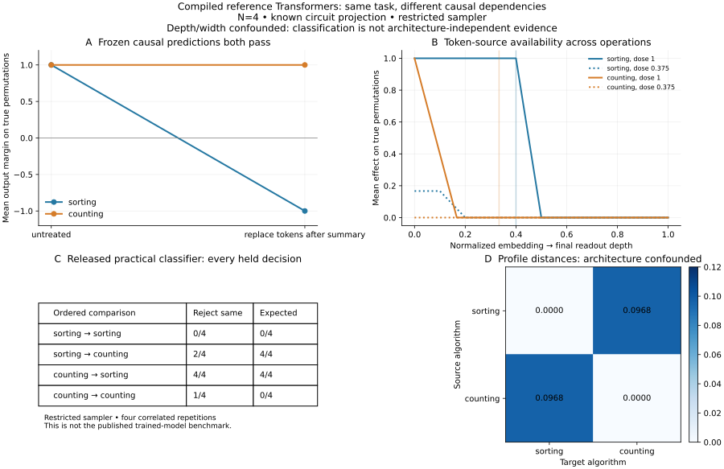

# Reference Transformer comparison: result and scope

**Outcome: NARROW for the controlled causal assay; NO-GO for claiming architecture-independent algorithm identification or method superiority.** The known causal predictions pass, but program identity is fully confounded with depth and width. A metadata-only rule also separates this bank. Exact positive transfer uses supplied circuit mappings. The released practical classifier was executed with every failure retained; this is not a reproduction of its trained-model benchmark.

Protocol freeze: [4638e145b88171b0f1423e4898ff2319bc920b0a](https://github.com/Joel-Vazquez-Lopez/relational-transfer/commit/4638e145b88171b0f1423e4898ff2319bc920b0a). One N4 run, no adaptive changes or retraining. Frozen source remains unchanged.



## Two distinct outcomes of this investigation

### Published trained-model reproduction: NOT RUN

The public Congruity code refers to a modified InterpBench checkout and a separate trained-variant/correspondence bank. Its download script points to an institutional SCP location. In the checked public InterpBench revision, only component tasks63 and124 of nine required task IDs are present: **zero of the six released algorithm chains is complete**. The checked rehost contains IOI models, not this bank; checked GitHub releases are empty. This does not prove artifacts are unavailable elsewhere, and is not a scientific failure of Congruity.

Rebuilding the original bank is a different project: the released training path requests up to120,000 examples per component and the shell script requests30 epochs, potentially reduced by early stopping. It is not the small checkpoint evaluation initially proposed. We did not reconstruct that bank, contact a private server, train replacement students, or quietly use unrelated checkpoints as equivalents.

Pinned inventories, exact URLs, source hashes and source inspection are in the sibling `transformer_comparison_feasibility_2026-10-18` directory. Its `PUBLIC_ASSET_AUDIT.json` records all six incomplete chains and the precise checked scope.

### Narrow compiled-reference alternative: completed

Two public algorithmic routines were compiled into genuine bidirectional softmax-attention/ReLU-MLP Transformers with official Tracr. The sorting route has5 layers and residual width48; the counting route has3 layers and width26. The weights are compiled from programs, **not learned from data**. This is a stronger known-circuit control than handwritten scalar or MLP examples, but does not establish linguistic processing in pretrained Transformers.

The reference task is recognizing whether a four-symbol sequence over {0,1,2,3} is a permutation. Both programs agree on every input. Their RASP mechanisms differ:

- Sorting route: compute stable ranks, aggregate sorted values, compare them with their indices.
- Counting route: compute equal-token counts, detect duplicates, negate the result.

This uses the algorithmic ideas from the published testbed; it is not its exact N10 multi-model-chain implementation.

## What was frozen and tested

- Both native models classify **256/256 inputs correctly**, **512/512 outputs combined**. Their margins are exactly±1 on the whole finite normal domain.
- The Torch adapter matches upstream JAX intermediate states within2.23e-16 on the two fixed N4 sanity inputs. Earlier N3 preflights were completed before freeze.
- A finite bank of16 mechanism-preserving implementations is generated: eight per program, split into four development and four held nuisance seeds. These are not16 independently learned algorithms.
- The sampler adds an independent attention/MLP residual branch of width8, ignored by the task readout, then permutes combined residual coordinates. It varies irrelevant computation, leaving the known native circuit unchanged. It is not the paper's implementation distribution.
- Development and held input sets are disjoint48-case sets, each12 true permutations and36 non-permutations. The full domain has24 true permutations; all are allocated between these sets. Outcomes therefore are not estimates over an unlimited language distribution.
- Every normal/sampler/sham/native-intervention control passes1e-8. The known permutation/projection transports the intervention exactly. This mapping is supplied by the compiler, **not inferred by our method**.
- **184/184 independent NumPy replay checks pass**, reconstructing every stored native intervention logit; max discrepancy6.67e-16. All32 practical-baseline decisions are independently reconstructed from saved regression-score pairs.

## Distinct causal predictions: both pass

The intervention replaces the original non-BOS token-value coordinates by token0 while preserving computed intermediate summaries. The summary stage is fixed from compiled nonzero writes, not selected from response peaks.

| Reference mechanism | Fixed summary stage | Predicted answer after token replacement on a true permutation | Observed on all12 held true permutations |
|---|---:|---|---|
| Sorting | 4, after sorted-position construction | Non-permutation: original values are still needed | All negative margins, as predicted |
| Counting | 2, after duplicate-count construction | Permutation: the computed counts suffice | All positive margins, as predicted |

The post-summary intervention produces different outcomes under the two known mechanisms despite identical untreated task performance. This validates the assay on the reference graphs. It is a controlled recovery of a deliberately known distinction, not discovery of a new algorithm in an opaque model.

The semantic landmarks differ across the programs and use ground-truth information. This oracle diagnostic cannot be presented as blind architecture alignment or as an equal-information comparison with representation-only methods.

## Developmental profile comparison

Measure token-replacement responses at every embedding/post-attention/post-MLP state. Fit monotone stage correspondence on development response profiles at doses .25,.75,1; evaluate individual held responses at new doses .125,.375,.625,.875. Effects are (clean margin−patched margin)/2, retaining all raw margins and both input classes.

The largest same-program development distance is0. The cross-program distance is.09677023, so the locked midpoint threshold is.04838512. The profile classifies **16/16 ordered source/target/held-implementation comparisons** correctly. These are only two native algorithms replicated across four held auxiliary branches, not16 independent algorithm discoveries.

Same-program individual held prediction RMSE is exactly0. This is an expected control result: the native computation and its intervention mapping are known and preserved by construction. It does **not** repair the prior learned-network cross-seed failure or show that we can infer a correspondence between independently learned hidden spaces. Negative-program cases and predictions are saved separately rather than counted as successful transfer.

The measured graded profiles differ in this small task, but that difference is confounded with the architectures of the two programs. We cannot attribute classification success to algorithm identity beyond architecture. This is a result about this intervention family, two programs and declared sampler. It does not establish a unique event-selection or linguistic mechanism, a universal computational path, or architecture-family laws.

## Design confound discovered in the post-run audit

Sorting has5 layers/width48; counting has3 layers/width26. Every sampled implementation preserves its native depth and adds the same width8 branch. Thus architecture and algorithm labels are perfectly confounded. A rule using only whether source and target layer counts match agrees with **16/16 labels**, exactly as the causal classifier does. This is a post-run design audit, not a new preregistered baseline or an additional neural experiment.

Accordingly, the classifier result cannot establish identification of algorithmic differences beyond generic architecture information. DTW does not by itself remove this confound. The baseline's directional errors may also be influenced by representation dimension or the restricted sampler; this run cannot isolate those causes. We did not run an outcome-driven architecture-balancing correction.

The semantic intervention contrast remains a valid manipulation of the known circuits: one route still needs original values after its summary, the other does not. That is the surviving narrow claim. The comparison is insufficient for a methods-paper advantage claim.

## Released existing-method classifier: exact functions, restricted setting

We executed the unmodified AST bodies of `encoder_fit` and `point_test` from the released `left/encoding.py`, pinned to Git blob abd3db7367317c51974a265026efb1649a4ec76a. The wrapper only logs regression scores. The code uses RidgeCV, a90/10 sample split, and a one-sided within-vs-across representation comparison, n20 and crit1.96. Four bootstrap repetitions are run for each ordered family pair, with all seeds fixed prospectively.

Representations average positions, including BOS, and concatenate all accumulated residual states. The baseline receives the full task+nuisance representation. There are no missing baseline warnings or dropped decisions.

| Ordered comparison | Expected “reject same” | Development rejects | Held rejects | Held correct |
|---|---:|---:|---:|---:|
| Sorting → sorting | 0/4 | 0/4 | 0/4 | 4/4 |
| Sorting → counting | 4/4 | 0/4 | 2/4 | 2/4 |
| Counting → sorting | 4/4 | 4/4 | 4/4 | 4/4 |
| Counting → counting | 0/4 | 0/4 | 1/4 | 3/4 |

All failures are retained: development misses all four sorting→counting distinctions; held misses two of them and has one false rejection for counting→counting. Overall held correctness is13/16 bootstrap decisions, a different unit from the causal method's16 implementation-pair decisions. These correlated small-sample counts are not a significance test or a leaderboard comparison. Directional behavior is reported explicitly; we did not symmetrize or tune the classifier after seeing it.

**What was not reproduced:** the published trained bank, its large implementation distribution, the full Figure2 experiment, or theoretical Algorithm1 using the constrained bidirectional representation norm in DefinitionG.1. The practical released functions are faithfully reused; the data and sampler are explicitly different. A scoped failure here is not a refutation of Congruity's theory or empirical paper.

Our causal assay is given known compiler token coordinates and exact transport, while the baseline is given observed representations. Their information access differs. Consequently this experiment licenses **no claim that our method is superior**. A fair comparative methods paper needs matched information, a broader appropriate sampler, trained implementations and a faithful full baseline configuration.

## What the saved learned-network failure says

The separately saved-data-only audit localizes the prior source23→target37 failure: **95.17% of its squared prediction error comes from stage1**. Its overall RMSE remains.14698, above the frozen.1 gate. All48 source×stage×grammar-cell summaries and1,536 individual case-stage-dose records are preserved in the feasibility directory.

That audit did not perform new inference, change the predictor or rescue the original criterion. It identifies where to investigate, not whether the cause is genuine learned-computation variation or a mismatched perturbation. The exact reference transfer in the present run must not be substituted for that failed learned-model result.

## Interpretation and prior work

The narrow positive result is now in actual reference Transformers: the controlled intervention recovers a known difference in sorting/counting source dependence, and known-coordinate positive profiles survive irrelevant computation and residual reindexing. The classification design does not exclude an architecture-only explanation. This supports using such controls to validate an instrument before interpreting open-ended pretrained-model trajectories.

It does not yet resolve the hard problem. The precise maps and circuit identities were supplied by compilation. Independent trained networks may represent, distribute or use information differently; our earlier failed transfer remains direct evidence that shared access alone is insufficient.

[Causal abstraction](https://arxiv.org/abs/2106.02997), [IIT](https://arxiv.org/abs/2112.00826), [InterpBench](https://arxiv.org/abs/2407.14494), and [Sun & Toneva's interpretive-equivalence work](https://arxiv.org/abs/2603.30002) already motivate known-circuit calibration and causal comparisons. None of those ideas is introduced by this experiment. No novelty claim follows from our16/16 control score or the restricted baseline's13/16 decisions.

[Dai et al.2024](https://aclanthology.org/2024.emnlp-main.967/) studies binding subspaces and representation edits in language models. The present finite permutation task establishes no new binding mechanism and does not supersede that work. The original objective—how linguistic meaning is progressively computed in LLMs—remains unproven by this reference study.

## Artifacts and reproduction

All main code and rules were frozen at4638e145 before N4 outcomes. `PREFLIGHT_REPAIRS.md` records missing-dependency/adapter API repairs before freeze; no scientific gate was repaired after evaluation. The source dependency is fetched by pinned URL/hash rather than re-licensed or silently modified.

Use the existing project Python with Torch, NumPy, scikit-learn and networkx:

```sh
research/stronger_model_development_2026-10-15/.venv/bin/python research/reference_transformer_comparison_2026-10-18/prepare_runtime.py
research/stronger_model_development_2026-10-15/.venv/bin/python research/reference_transformer_comparison_2026-10-18/reference.py
research/stronger_model_development_2026-10-15/.venv/bin/python research/reference_transformer_comparison_2026-10-18/preflight.py
research/stronger_model_development_2026-10-15/.venv/bin/python research/reference_transformer_comparison_2026-10-18/study.py
research/stronger_model_development_2026-10-15/.venv/bin/python research/reference_transformer_comparison_2026-10-18/audit.py
MPLCONFIGDIR=/private/tmp/reference_transformer_mpl research/stronger_model_development_2026-10-15/.venv/bin/python research/reference_transformer_comparison_2026-10-18/report.py
```

Reproduce in a separate copy. The main run requires a freeze receipt and refuses to overwrite an existing results directory. The isolated compiler/runtime is intentionally not committed; the setup script pins its versions/source. No shared environment was modified. Library downloads were compiler dependencies, not large model weights. The full main experiment took5.40 seconds locally; setup, auditing and export are separate.

`weights.npz` stores every native and auxiliary weight/permutation. `raw_outputs.npz` includes raw logits, all states, effects, representation banks and individual held predictions. Raw logit/effect axes are case×stage×dose. State axes are case×stage×position×dimension. Baseline representation axes are implementation×case×feature. Model metadata specifies input encodings, stage cuts, basis labels and readout coordinates. `RIDGE_CALLS.json` records every fitted R² with its source/target implementation IDs; `CONGRUITY_CODE_BASELINE.json` records all32 decisions. Inputs, controls, warnings, execution logs, oracle audit, hashes and plots are preserved.

**Stopped after this one reference experiment.** No new task, trained-bank reconstruction, adaptive sampler change, extra model training, paid API or pretrained LLM inference followed the results. The appropriate conclusion is a successful reference assay with limited baseline reuse, not a demonstrated publishable novel mechanism.
