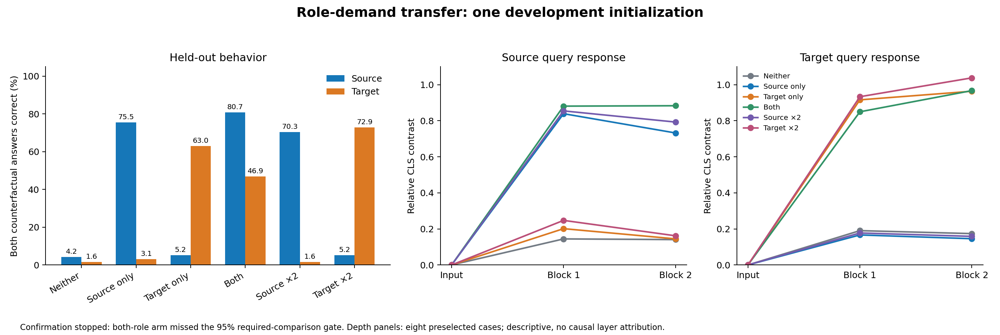

# A role-selective development result, with confirmation stopped

**20 October 2026. Outcome: STOP_DEVELOPMENT_GATE.** Six small Transformer training arms completed. The predicted contrast produced an interesting development pattern, but the combined-role arm missed its preregistered learning criterion. **No confirmation models ran. No significance or novel mechanism is established.**

## What we actually executed

- Generator preflight, before any model initialization: exact positive/candidate frequencies, broad comparison spectra, coupled query/answer/positive-scene indices, all720 identity relabelings, three rendered layouts, candidate/query-only shortcuts, unordered-query shortcut, and actual encoded-input merger witnesses.
- One untrained technical reference: direct versus traced forwards, identity copies and candidate-order permutation all agreed exactly.
- Six development arms at one paired initialization and identity relabeling,3,000updates each. All arms began with identical parameters, used the same positive training cases and minibatch indices, and differed in the prescribed comparison grouping.
- Each model had3,072 final held-out answers, forming768 source pairs and768 target pairs. A pair passes only when both focal identities are answered correctly. There are768 complete four-question cases per model.
- Training:18,000updates,2,304,000sampled examples. Collection wall time272.85seconds. Evaluation accounting includes164,491examples in1,293batches, plus272trace examples in31batches; these are computational counts, not independent observations.
- Forty-eight planned confirmation models were **not run**, because the automatic frozen gate stopped collection.

The pre-output lock was published at commit `4d1012e970f195e26e15e56c85d54046952e39fd` before model initialization. Frozen source bytes remain unchanged. The initial NumPy compatibility repair and the analytical revision of the cycle baseline both occurred before model initialization and are preserved separately.

## The development finding

| Comparison training | Source paired correct | Target paired correct | All four correct | Familiar accuracy |
|---|---:|---:|---:|---:|
| Neither focal role |32/768 = **4.2%** |12/768 = **1.6%** |0/768 =0.0% |100.0% |
| Source only |580/768 = **75.5%** |24/768 = **3.1%** |16/768 =2.1% |100.0% |
| Target only |40/768 = **5.2%** |484/768 = **63.0%** |24/768 =3.1% |99.7% |
| Both |620/768 = **80.7%** |360/768 = **46.9%** |272/768 =35.4% |97.2% |
| Source double dose |540/768 = **70.3%** |12/768 = **1.6%** |4/768 =0.5% |100.0% |
| Target double dose |40/768 = **5.2%** |560/768 = **72.9%** |28/768 =3.6% |99.7% |

These are repeated test conditions of six models with **one shared initialization**, not hundreds of independent experiments. No case-level p-values or confirmation-seed statistics are appropriate.

The important pattern is selective: training source comparisons helped source discrimination on unseen relations, with little target benefit; target training showed the reverse. Doubling a single-role dose did not yield broad cross-role transfer. The combined arm helped both, but performed worse than target-only on target pairs and was harder to learn. This last observation is exploratory and retains a generic optimization/interference explanation.

The narrow phenomenon is **argument-slot-conditioned entity discrimination and transfer**. This is more precise than claiming the model newly learned “who did what to whom.” The model generally selected the right argument slot even when it selected the wrong focal identity. Of5,980incorrect final held answers,5,956were wrong focal identities within the requested argument;24were wrong-argument selections. Every final wrong answer, its query, predicted meaning, label and position is in [WRONG_ANSWERS.csv](WRONG_ANSWERS.csv).

## Why confirmation stopped

All six models passed the≥95% familiar test and exact identity controls. Baseline headroom and a≥10point treatment effect also passed. The remaining frozen criterion required≥95% accuracy on fresh renderings of every explicitly trained focal contrast.

| Arm | Fresh required source | Fresh required target |
|---|---:|---:|
| Source only |98.61% |Not required |
| Target only |Not required |99.31% |
| Both |**93.75% — fail** |**94.44% — fail** |
| Source double |98.26% |Not required |
| Target double |Not required |98.96% |

The both arm also had94.25% accuracy across its complete fresh-context panel. The shared familiar test and the treatment-specific focal learning test measure different competence. Passing the former did not override failing the latter.

The gate was not lowered to admit this result. We did not increase updates, drop the combined arm, select the best checkpoint, modify the dataset, or start a replacement confirmation study. The selective pattern is valid **development evidence**; it is not a completed confirmatory result. The failed combined-arm gate prevents a clean whole-factorial mechanistic decision under the frozen protocol.

## What the saved layers show

Secondary depth analysis used the eight cases selected before inference. It read saved arrays only; it did not run another forward pass or select an intervention site. Because this query encoder does not consume candidate scenes, those eight cases cover all eight unique held-query types; query states do not change with candidate geometry/rotation. The candidate-state traces cover only one selected panel per event.

Within each model, the changed-name embedding distance is the same in source and target query slots: the embedding table is shared, and the positional additions cancel in that particular token difference. This is an architectural control, not a discovery. The later query-CLS contrast becomes strongly dependent on the trained argument slot.

| Training | Changed-name embedding distance, both slots | Block1 CLS contrast, source / target | Block2 CLS contrast, source / target |
|---|---:|---:|---:|
| Source only |0.8009 |6.167 /0.942 |7.327 /1.316 |
| Target only |0.8039 |1.269 /4.270 |1.316 /6.106 |

Values are raw L2 contrasts averaged over the two event variants in the fixed trace panel. [DESCRIPTIVE_DEPTH.csv](DESCRIPTIVE_DEPTH.csv) retains all arms, all saved training checkpoints, raw magnitude and relative-to-state-norm magnitude. The figure uses relative magnitudes and the same scale for both depth panels. [Learning curves](DEVELOPMENT_LEARNING_CURVES.png) show every saved update without checkpoint selection.

This suggests a **slot-conditioned amplification/suppression** candidate: the same name distinction becomes more influential in one query context than another. A uniform increase in embedding-distance magnitude alone does not explain the observed selectivity. However, global identity features followed by context-dependent processing/readout remain compatible. Ordinary position-conditioned lookup can also produce this pattern. The shared word embeddings do not imply identical full input states because the changing token occupies different positions.

The first block boundary already exhibits the difference. We have not isolated attention versus MLP, established a causal mediator, identified which tokens transmit it, or shown that this trace difference explains individual decisions. We have not separated construction of a relation from preparation of the final readout. Block-boundary contrasts are not a circuit discovery. Coverage of the unique query types does not replace independent replication or broad candidate-state coverage.

## Controls, failures and limits

- **Exact audit:**37,194checks passed across raw arrays, metadata joins, stored initial checkpoint tensors, paired minibatch RNG states, individual/paired endpoints and frozen file hashes. This is independent arithmetic/integrity verification, not independent model replication.
- **Input controls:** candidate-only and query-only individual-answer ceilings25%; unordered query ceiling6/7; no-event query ceiling50%. Reversal blocks are necessary to prevent a completely unordered query solution. Direct focal comparison demand is independently controlled per slot.
- **Matched exposure:** every arm has the same positive meanings and exact positive scenes, candidate marginals, total examples and broad comparison-type counts. The off baseline has identical focal partner distributions. Comparison regrouping still changes the experienced gradients and context combinations; generic difficulty is not eliminated as a universal explanation.
- **Object order:** final familiar object-reversal agreement was100% in five arms and96.875% in source-double on the128case control. No case or arm was removed. Do not claim perfect object-order invariance across the cohort.
- **One graph, one development seed:** identity relabelings in preflight are validity checks, not training replications or new graph topologies. The planned eight confirmation seeds remain unobserved.
- **Synthetic argument slots:** the experiment uses a small oracle-message/candidate Transformer. It has no active/passive syntax, unfamiliar vocabulary, natural corpus, Qwen or Llama. It cannot establish semantic-role invariance independently of token position or a cross-model law.
- **Primary metric:** original and counterfactual answers must both be correct on all cases. Native-competent-only filtering did not replace the primary estimate. Repeated geometries/rotations are not independent statistical units.
- **No adaptive rescue:** all frozen stopping rules were retained. No extra model run followed the failed gate.

## Relation to the research objective

We now have a more concrete development phenomenon than generic path similarity: under matched exposure, the trained model can become selectively sensitive to the same identity distinction in one argument context while remaining weak in the other. Its query response diverges within the first block. That is a usable target for a future replication and a causal process investigation.

It remains one development result. We have not shown that the phenomenon is new to the literature, that linguistic semantic roles share this behavior, or that different LLMs construct relations through the same sequence. The related-work limits in [DESIGN.md](DESIGN.md), including Dai et al., gradient starvation and feature averaging, remain applicable.

**Decision: retain the role-selective pattern as a provisional candidate; stop the present study at its failed development gate.** Any later replication needs a separately frozen design with untouched initialization units. This run cannot be promoted to confirmation by retrospectively omitting the arm that failed.

## Reproducibility

- [Protocol](FACTORIAL_PROTOCOL.md), [frozen lock](FROZEN_LOCK.json), preflight and scripts preserve the exact design.
- [Generated outcome](FACTORIAL_REPORT.md), [machine decision](FACTORIAL_RESULTS.json), [model endpoints](MODEL_ENDPOINTS.csv), [development gate](DEVELOPMENT_GATE.json), and [compute accounting](COLLECTION.json) retain all six outcomes and the stop.
- Raw training/evaluation inputs, every saved score vector, traces, full model/optimizer/RNG checkpoints and metadata are preserved in the verified RAW_FACTORIAL archive parts. The member manifest gives per-file hashes and restoration instructions. Originals remain local.
- Post-collection plots and the independent audit use saved data only. Training and decision code hashes remain those published before initialization.
