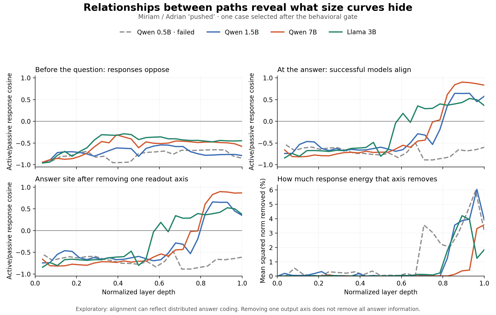
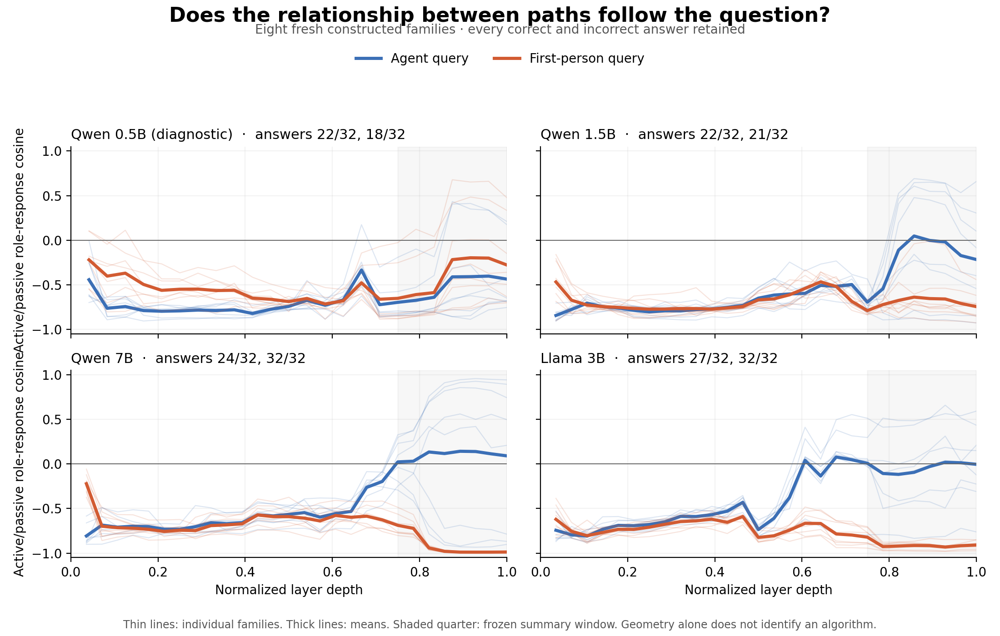

# What the trajectory programme can currently establish

**17 October 2026. Final outcome: NARROW.** A fresh bounded diagnostic supports task-conditioned response geometry in Qwen 7B. It does not establish shared semantic computation or a model-family law. The full three-primary-model success rule failed. No additional adaptive experiments follow this report.

## The correction to our research direction

The user's idea concerns relationships between computational responses. The recent distance-vs-depth lines only measured response **size**. They discarded direction, so they could not test that idea adequately. The earlier competence stops were appropriate for the specific causal transport studies; they do not make observational analysis of correct and incorrect processing impossible.

I audited the existing frontier, trajectory, factorial, transport and family-competence reports, then reanalysed the saved vectors. I used only existing local models and infrastructure. No training, download, paid API or activation patch was used in this audit. The fresh diagnostic below was separately locked before its outputs; it does not reopen the stopped causal studies.

## 1. A relation hidden by the size curves

For the exposed Miriam/Adrian *pushed* family, define the role-reversal response in each voice with the same orientation: `d = h(A-Agent) - h(B-Agent)`. Compare active and passive responses by cosine at each layer. This comparison stays inside each model's coordinates; the experimental labels give a common interpretation across different hidden dimensions.

| Model | Late event-end cosine | Late answer-site cosine | Answer cosine after one readout axis is removed |
|---|---:|---:|---:|
| Qwen 0.5B | -0.709 | -0.736 | -0.735 |
| Qwen 1.5B | -0.770 | +0.447 | +0.422 |
| Qwen 7B | -0.503 | +0.712 | +0.708 |
| Llama 3B | -0.451 | +0.428 | +0.424 |

These summaries use the final seven blocks, as specified for the exploratory reanalysis. The event-end responses remain opposed, whereas the three models that answered all four questions correctly align near the answer. Qwen 0.5B failed the family and remains opposed. This is **one family selected after its behavioral results**, not independent confirmation.

The readout diagnostic applies the native final RMSNorm to saved states and removes the shared first-answer-token Miriam-minus-Adrian output-weight axis from both response vectors. Selected weights reproduce native head logits within 0.00082. The axis removes about 1.1–3.4% of late response energy; most alignment remains. Removing 256 fixed-seed random axes changes the cosines very little. This excludes one direct readout axis as a complete explanation, not distributed answer coding. Earlier-layer use of the final norm/head is a logit-lens convention; the names contain multiple tokens. Full metrics are in [RELATION_AUDIT.json](RELATION_AUDIT.json).

## 2. The strongest simple counterexample survives

I implemented a hand-defined program that looks up the answer from **voice × name order × question**, then writes a distributed answer code. It carries first-mentioned identity and a query-specific answer; it does not store a separate reusable role vector before the question. This is a qualitative counterexample, not a fitted account of an LLM.

It produces identical response-size curves for an Agent query and a first-name query. For the Agent query, its active/passive response cosine moves from -0.995 to +0.885. Removing its direct output axis leaves +0.883. For the first-name query, cosine stays -1 while every answer is correct. Thus a sign change, correct answers, and survival after one-axis removal can all arise from a simpler surface-keyed computation. This does not show that an LLM uses that computation; it shows why those observations cannot identify a unique role mechanism.

The exact assertions and outputs are in [copying_counterexample.py](copying_counterexample.py) and [COPYING_COUNTEREXAMPLE.json](COPYING_COUNTEREXAMPLE.json).

## 3. Fresh question-conditioning diagnostic

The [QUERY_LOCK.json](QUERY_LOCK.json) and [runner](run_query_pilot.py) were saved and hashed before fresh inference. Lock SHA-256: `3735367fce044f102a13bd27df718d62fea62760d96ef61b6c2a9887c7baadeb`. Runner SHA-256: `43153fe27a7231dfe37d06dac11f8d09abe09158b8af5e5bc3bba415ec5f2567`.

Eight fresh constructed lexical families covered *chased*, *tapped*, *visited* and *photographed*, each with two name pairs. Four sentence cells crossed role assignment and active/passive voice. Each sentence received an Agent question and a first-mentioned-person question. This gives **64 answers per model, 256 total**, plus all-layer states at event end and answer-prompt end. The data are controlled synthetic sentences, not human-annotated corpus documents. The doer and first-name labels follow the frozen sentence templates; there are exactly two people and one event per sentence.

The response orientation always refers to the Agent, including for the first-name query. Accurate Agent answers preserve name identity across voices; accurate first-name answers reverse it. We predicted greater late active/passive cosine for the Agent task if answer-conditioned processing contributes. A question-insensitive generic layer schedule alone does not predict that signed task difference. A surface-keyed answer copier does predict it.

The primary summary was fixed to the final quarter of blocks, with **all eight families included regardless of correctness**. To pass the descriptive pilot, each primary model needed at least two fully competent eight-answer families, mean cosine difference >0.25, negative first-query cosine on the competent subset, and pre-question state invariance within 0.001 relative norm.

| Model | Agent answers | First-name answers | Fully competent families | Mean late Agent cosine | Mean late first cosine | Difference | Frozen rule |
|---|---:|---:|---:|---:|---:|---:|---|
| Qwen 0.5B, diagnostic | 22/32 | 18/32 | 0/8 | -0.524 | -0.392 | -0.132 | fail |
| Qwen 1.5B | 22/32 | 21/32 | 1/8 | -0.214 | -0.699 | +0.485 | fail: competence |
| Qwen 7B | 24/32 | 32/32 | 3/8 | +0.099 | -0.911 | +1.010 | pass |
| Llama 3B | 27/32 | 32/32 | 3/8 | -0.039 | -0.907 | +0.868 | fail: technical control |

The full primary-model criterion therefore **failed**. Qwen 7B's paired difference was positive in all eight families. Llama also had eight positive differences but cannot be counted as a clean replication under the frozen technical rule. Qwen 1.5B had six positive differences and Qwen 0.5B had two. No model, family or failure was substituted.

For Qwen 7B, removing the first-answer-token margin axis leaves a mean task difference of +1.017. However, the sign of a scalar output-response baseline matches **16/16** final geometric signs (eight families × two questions). This baseline does not reconstruct every vector or cosine magnitude, but it is a strong competitor to a semantic interpretation. The copying counterexample demonstrates why one-axis removal does not defeat that competitor.

**Figure caution:** Llama's panel is a recorded outcome with a failed technical control. Its event-end states differed between later-question conditions by up to **0.003827 relative norm**, exceeding the frozen 0.001 tolerance. The maximum occurred for q06, B-Agent active, final block. The text through the event and the event-token index were identical. Sequence-shape numerical effects are plausible, but the cause was not established; the tolerance was not relaxed and no rerun was performed. Qwen event-end states were identical across the two question conditions.

Every family-level result is in [QUERY_FAMILY_LEDGER.csv](QUERY_FAMILY_LEDGER.csv), and all 256 individual answers, including unexpected names, complete-sentence outputs and ties, are in [QUERY_ANSWER_LEDGER.tsv](QUERY_ANSWER_LEDGER.tsv). Complete prompts and full-name scores are preserved in the four `QUERY_<model>.json` files. [QUERY_SUMMARY.json](QUERY_SUMMARY.json) records the fixed decision. The four local `QUERY_STATES_<model>.npz` files preserve all captured vectors and readout axes, with hashes in the raw records and manifest.

## 4. Surviving claim and limitations

The supported claim is bounded: **for this Qwen 7B panel, the relationship between role-reversal response vectors depends strongly on which retrieval task is requested.** It is not a universal property of the sentence alone. This is a real measurement result with fresh cases, but not yet a novel mechanism or a paper-ready general law.

The task texts differ in wording and length, so this pilot does not isolate abstract question meaning from surface effects. The name/verb families are small and non-random; two families share each verb. No layer is an independent observation and no population significance claim is made. All-family averages mix successful and unsuccessful task execution; competent subsets are separately identified rather than silently replacing failures. The output-axis diagnostic removes one scalar first-token distinction only. The observation and toy do not refute every possible relational atlas; they constrain the interpretation of this specific descriptor.

## 5. Relation to prior research

- [Dai et al. (EMNLP 2024)](https://aclanthology.org/2024.emnlp-main.967/) already localize a low-rank binding-related subspace and redirect attribute retrieval. A generic redirection or ordering-based code is not a novelty claim available to us.
- [Gur-Arieh, Geva and Geiger, *Mixing Mechanisms* (ICLR 2026)](https://arxiv.org/abs/2510.06182) show that positional, lexical and reflexive retrieval mechanisms combine across tasks and models. Their full causal model is a substantially stronger mechanistic result than the present geometry.
- [Oh and Demberg (2026)](https://arxiv.org/abs/2606.08644) already identify a retrieval-conditioned rebinding circuit with different representational signatures across Gemma and Llama. Thus “same function, different family geometry” is already established in a specific setting.
- [Denning et al. (2024)](https://escholarship.org/uc/item/35x5m9cm) compare thematic roles and syntax in representations; [Aljaafari et al. (2026)](https://aclanthology.org/2026.findings-acl.1964.pdf) compare role circuits across model scales/families. We should not claim the first cross-model semantic-role analysis.
- [Ding et al. (NeurIPS 2021)](https://arxiv.org/abs/2108.01661), [Friedman et al. (2023)](https://research.google/pubs/comparing-representational-and-functional-similarity-in-small-transformer-language-models/), and [ReSi](https://github.com/mklabunde/resi) already study the limits and functional grounding of representation similarity. A broad “geometry is not computation” paper would duplicate existing work.
- [DSA](https://papers.neurips.cc/paper_files/paper/2023/hash/6ac807c9b296964409b277369e55621a-Abstract-Conference.html), [InputDSA](https://proceedings.iclr.cc/paper_files/paper/2026/hash/5a437d77270d5588a84d63a851a3fdeb-Abstract-Conference.html), and [Sun and Toneva (2026)](https://arxiv.org/abs/2603.30002) directly address dynamical or mechanistic comparison. A new cosine formula is not sufficient differentiation.

## 6. The investigation worth pursuing

The strongest remaining question is: **Can a comparison of developmental responses distinguish a reusable relation from a requested answer, after those two variables are varied independently?** This preserves the user's original vision while putting a sharp competitor in the experiment.

A credible next paper investigation would calibrate candidate measures on known programs with the same answers but different intermediate dependencies, then test whether a descriptor predicts selective native interventions on untouched constructions. It must include relation-matched/different-answer and answer-matched/different-relation pairs; a common depth schedule; surface order and compound-key rivals; fixed mappings across questions; and held-out lexical and construction families. Both semantic and positional questions must be retained. The endpoint must beat an output-only predictor, not merely show a high cosine.

This is a **design recommendation**, not an executed further experiment or novelty claim. The current pilot supports investing in that measurement-validity question; it does not justify a model sweep or declaring a shared path. If a credible competing implementation predicts every available endpoint equally well, the mechanistic branch should stop. A precise methodological boundary paper remains possible only if the specific failure mode replicates, matters for existing methods, and is distinct from the prior work above.

## Reproduction and preservation

Use the existing MLX virtual environment in `research/stronger_model_development_2026-10-15/.venv`. Run `extract_readout.py MODEL` for the saved-state readout diagnostic, then `analyze_relations.py` and `copying_counterexample.py`. Run `run_query_pilot.py MODEL` once per model, then `analyze_query_pilot.py` and `export_records.py`. Runners refuse to overwrite raw outputs. All scientific scripts, frozen locks, complete raw text outputs, ledgers and figures are retained. Tensor archives are preserved locally with SHA-256 checksums; they are not model weights. No further inference or adaptive experiment was run after the outcomes above.
