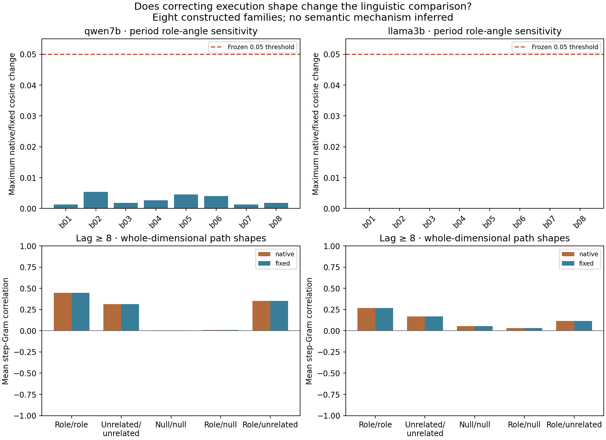
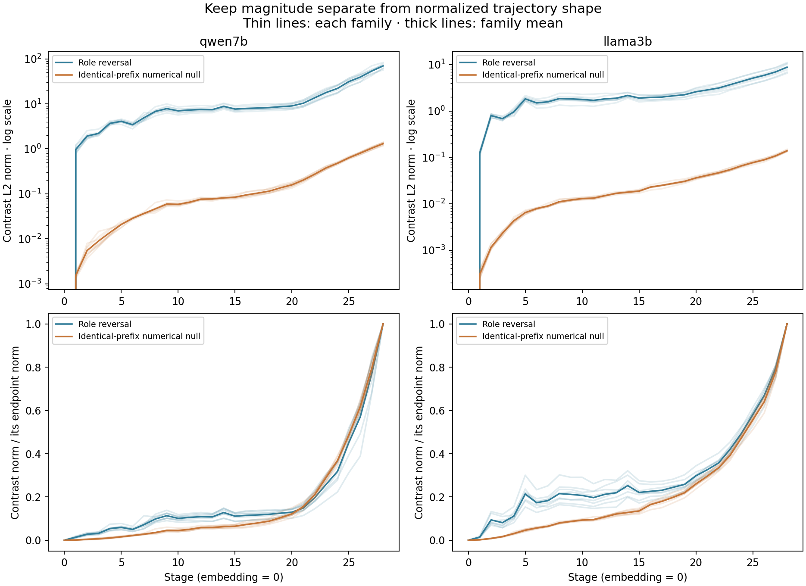

# Trajectory specificity benchmark — 18 October 2026

## Frozen question and outcome

Can numerical contrast paths look coherently structured, and does fixed-shape extraction materially change the primary sentence-period linguistic comparison? Eight newly constructed lexical families were declared before inference. No model answer was evaluated, so this is a measurement benchmark rather than a semantic competence or causal mechanism test.

Frozen decision fields: `{"technical_pass": true, "angle_material_in_both_models": false, "primary_gap_sign_reversal_any": false, "answers_scored": 0, "causal_patches": 0, "population_or_mechanism_claim": false}`.

| Model | Forwards | Content null passed | Cases with angle change >0.05 | Null within-Gram, lag 1 | Null within-Gram, lag 8 |
|---|---:|---|---:|---:|---:|
| qwen7b | 88 | True | 0/8 | 0.318748 | 0.003595 |
| llama3b | 88 | True | 0/8 | 0.745380 | 0.053821 |

Every angle, rank-gap sign, leave-one-family-out sensitivity, cross-model pairing and CKA value is retained in SUMMARY.json and the ledgers. Pairs share families, cyclic unrelated contrasts share sentences, and layers share a network; none is an independent replication. Leave-one-out summaries remove any unrelated path involving the omitted family, without redefining that path. They are sensitivity checks, not confidence intervals.

## Interpret the scale and specificity separately

A nonzero numerical null can have a well-defined normalized Gram even though its mathematical input prefix is unchanged. A high correlation describes normalized numerical-error geometry, not shared linguistic computation. Conversely, a small absolute error does not imply that a linguistic conclusion changes. The fixed primary materiality criterion and sign comparisons distinguish these questions; if they remain stable, this study supplies evidence against blaming the main period-level linguistic comparison on this artifact.

## Complete results and controls

RAW_<model>.json preserves every prompt, token ID, token site, native length, exclusion and content-null result. STATES_<model>.npz contains embedding plus every block output at four sites. DESCRIPTORS.npz contains every step Gram, norm and speed. PAIRWISE.csv includes all prespecified within/cross-model category pairs; PATHS.csv, ANGLES.csv, NULLS.csv and CKA.csv provide separate views. The primary site is the sentence period; the first-person identical-prefix channel is explicitly checked and saved as a negative control. Undefined zero-vector directions remain missing rather than receiving a fabricated cosine.

The artifact reference is the native 65-minus-64 numerical contrast in both extraction-mode comparison tables. This intentionally asks whether native/fixed linguistic paths resemble the same numerical reference. It is not a claim that the corrected same-shape null stays nonzero; that separate null is reported in NULLS.csv.

Cells reverse roles and active/passive voice but also change lexical order and syntax. They are controlled language contrasts, not isolated semantic variables. CKA has only eight family samples and is descriptive. Native/fixed comparisons share one MLX backend/device; two architectures are not two independent runtimes. No independent evaluator or corpus annotations are claimed. No target-model coordinate alignment, PCA, learned probe or smoothing was fitted.

## Prior-work boundary

[Same Probe, Different Numbers (September 2026)](https://arxiv.org/abs/2609.31796) directly studies activation-monitor robustness to serving numerics and reports that high global representational similarity can coexist with local changes. It is a close precedent; discovering numerical activation differences alone is not a contribution. Our narrower benchmark concerns normalized contrast-path descriptors and exact causal-prefix nulls, without probe training or generated-text divergence. That difference does not establish priority.

[Thinking Machines Lab (2025)](https://thinkingmachines.ai/blog/defeating-nondeterminism-in-llm-inference/) establishes shape-dependent reductions. [Ding et al. (2021)](https://arxiv.org/abs/2108.01661) and [ReSi (2025)](https://arxiv.org/abs/2408.00531) already ground similarity measures in function and nuisance controls. [DSA](https://arxiv.org/abs/2306.10168) already compares dynamics rather than static geometry; distinct feedforward blocks are not automatically a stationary recurrent system. [Dai et al. (2024)](https://aclanthology.org/2024.emnlp-main.967/) already demonstrates causal binding edits. This benchmark does not identify a new semantic mechanism or validate a novel similarity measure.

## Reproduction and stopping

Use the existing local MLX environment: run_benchmark.py qwen7b and run_benchmark.py llama3b, then analyze.py. The runner refuses a second start. Protocol and source hashes were saved before loading either model. Existing local weights only; no training, model download, paid API or adaptive follow-up. Complete verbose JSON/CSV files are preserved losslessly in gzip for the research branch; full state archives remain local with committed checksums.
