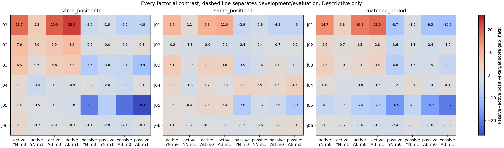

# Sentence voice × question voice × answer code: completed fixed experiment

## Mechanistic conclusion: NO-GO

The collection and technical audits completed successfully. The counterbalanced assay produced **401/768 correct first-token decisions (52.2%)**, and **0/6 families** passed the full clean-routing gate. Neither prespecified pattern family selected a development candidate or achieved prospective replication.

The original-prompt comparison recurred: active sentences gave14/24 correct first-token decisions and0/6 complete four-answer units; passive sentences gave24/24 and6/6. The stricter controls leave a real construction-dependent output phenomenon but no cleanly identified mechanism. In particular, the low crossed-task performance prevents attributing score changes uniquely to relational computation rather than question interpretation, answer-code use or output preparation. This is the decision about the current assay; no population significance or novelty claim is supported.

The figure includes every frozen contrast. Column labels “active/passive” refer to **question voice**; colors show passive-sentence minus active-sentence entailed-score gaps. Prefix0 is empty, prefix1 is `Record: `, and `matched_period` compares passive prefix0 with active prefix1. Mapping0 is normal; mapping1 is reversed. The dashed line separates development and held-out families.

## Decision

**No prespecified pattern prospectively replicated. No distinct event-selection or role-binding mechanism is established.**

This is one existing local 4-bit Qwen 7B checkpoint and six AI-authored lexical families. Three families were development cases and three were held out. The conclusions concern the frozen operational patterns; they are not population significance or novelty claims.

All **1117 planned calls** completed: 816 native scientific prompts, 288 fixed cut-14 interventions and 13 validation calls. 248 of these logical outputs are reused byte-for-byte from the preserved partial run. This continuation uses 869 new panel forwards plus 28 worker-equivalence controls. Including 252 previous attempts, the combined cap is **1,149 attempts**; prior failed and incomplete outputs remain preserved. The checkpointed continuation and bounded resource controls were frozen before any new forward; see FREEZE_RECEIPT.json for the commit.

The original 128/192 numerical gate remains failed (.0859375 > .05). The subsequent interrupted first fresh validation remains recorded with no payload. This execution uses the already frozen uniform 128-token design and the explicitly recorded restart exception. No failed tolerance was raised and no scientific source, prompt, site, score or hypothesis was changed.

## Prospective decisions

- Development-selected behavioral candidate: `None`. Held-out qualifying families: None/3; replicated: False.
- Development-selected routing candidate: `None`. Held-out qualifying families: None/3; replicated: False.
- `None` means no development candidate; a held-only pattern cannot become a prospective success.

|Family|Split|Old-prompt positive gap, nats|New-task symbol compliance|Qualifying behavioral pattern|Clean routing control|Qualifying routing pattern|
|---|---|---:|---:|---|---|---|
|j01|development|28.773|93.8%|none|False|none|
|j02|development|29.430|99.2%|none|False|none|
|j03|development|21.891|98.4%|none|False|none|
|j04|held out|18.789|100.0%|none|False|none|
|j05|held out|17.359|93.0%|none|False|none|
|j06|held out|38.461|100.0%|none|False|none|

The old-prompt gap is passive minus active mean target-aligned score on entailed cases. All 24 factorial contrasts per family, including the matched-position comparisons, remain in RESULTS.json and the figure. A family must satisfy every frozen contrast and compliance condition to qualify.

## Native answers and complete four-answer units

These counts use vocabulary-wide first-token argmax, not generated full responses or a calibrated classifier. Each unit crosses role orientation × question direction. Aggregation below pools question voice, mapping and prefix only for readability; NATIVE_CELL_TABLE.csv retains all 32 cells.

|Sentence voice|Code lexicon|Correct answers|Complete four-answer units|Symbol-compliant answers|
|---|---|---:|---:|---:|
|active|YN|96/192|1/48|179/192|
|active|AB|104/192|3/48|192/192|
|passive|YN|97/192|0/48|185/192|
|passive|AB|104/192|1/48|192/192|

### Every family

|Family|Original-prompt answers|Original whole family correct|New-task answers|New-task whole family correct|
|---|---:|---|---:|---|
|j01|6/8|False|68/128|False|
|j02|6/8|False|64/128|False|
|j03|6/8|False|64/128|False|
|j04|7/8|False|64/128|False|
|j05|7/8|False|77/128|False|
|j06|6/8|False|64/128|False|

All **516 incorrect scientific answers**, including **20 off-format answers**, are retained in UNEXPECTED_ANSWERS.json with expected/actual classes, emitted tokens, top-12 output tokens, scores and payload hashes. ANSWER_LEDGER.csv includes every answer. No competence exclusion changed collection or group means.

## Fixed causal panel

All interventions use canonical A/B normal mapping, empty prefix and cut 14. Frozen, closed and irrelevant-source masks were run for every canonical prompt regardless of native correctness. Retention is D_mask/D_native only when D_native ≥ .5; D combines all four role × question answers. The clean routing criterion additionally requires all ordinal comparisons positive and irrelevant-mask retention within .25 of 1 in every canonical unit.

|Family|Sentence voice|Question voice|Native D|Frozen retention|Closed retention|Irrelevant retention|
|---|---|---|---:|---:|---:|---:|
|j01|active|active|0.902|12.485|1.420|0.775|
|j01|active|passive|2.777|0.118|0.018|1.565|
|j01|passive|active|9.602|0.288|0.076|0.685|
|j01|passive|passive|0.211|undefined|undefined|undefined|
|j02|active|active|0.758|7.124|2.088|0.665|
|j02|active|passive|0.320|undefined|undefined|undefined|
|j02|passive|active|3.871|0.698|0.115|0.359|
|j02|passive|passive|0.375|undefined|undefined|undefined|
|j03|active|active|0.766|3.770|2.469|0.546|
|j03|active|passive|3.258|0.312|0.658|0.632|
|j03|passive|active|3.941|0.377|0.112|0.489|
|j03|passive|passive|1.996|1.372|1.769|0.753|
|j04|active|active|1.027|6.224|0.357|0.300|
|j04|active|passive|1.895|0.130|0.144|1.006|
|j04|passive|active|1.391|1.323|1.584|0.947|
|j04|passive|passive|0.660|9.615|4.154|1.254|
|j05|active|active|1.184|3.290|1.647|0.726|
|j05|active|passive|11.934|0.371|0.037|0.874|
|j05|passive|active|0.168|undefined|undefined|undefined|
|j05|passive|passive|1.473|1.477|0.721|1.218|
|j06|active|active|0.879|1.458|0.080|0.893|
|j06|active|passive|1.082|0.711|0.747|0.881|
|j06|passive|active|0.605|1.323|0.626|0.342|
|j06|passive|passive|-0.207|undefined|undefined|undefined|

An irrelevant-mask failure remains a failed interpretability control. The irrelevant mask matches the edge count, not attention mass or all token positions. Closed-mask rescue does not identify role content or establish that the period carries a unique relational message.

## Verification and artifacts

- All 828 production controls passed, including native/wrapped/dense/repeated forward comparisons, sham interventions, causal prefix checks, future-legend invariance and cut-0 disconnections.
- Independent analysis passed 8125 checks, replaying full-vector scores, argmax decisions, tensor shapes, hashes, call journals and the pre-evaluation prediction hash.
- Every call retains its full vocabulary output vector losslessly. Native calls retain all 29 residual stages at sentence period, question end and assistant end; masked calls retain five depth anchors and full-trace/prefix hashes.
- PAYLOAD_BUNDLES.json and verified tar bundles preserve the original compressed NPZ bytes. PACKAGED_REPLAY_AUDIT.json verifies every member and score after packaging. The expanded staging copies are removed only after exact member verification.
- INPUTS.json, SOURCE_MANIFEST.json and TOKENIZER_AUDIT.json retain source text, AI-only annotation uncertainties and position matching. Names and predicates are confounded at family level; these are authored templates, not natural documents.

## Interpretation and prior work

The tested explanations are strict operational predictions, not an exhaustive account of linguistic computation. A failed pattern rules out its specified joint predictions in this panel. It does not establish that relational processing is absent. A successful pattern establishes only the tested construction/question/code dependence. General syntax-aware copying, output preparation and instruction interpretation can remain viable.

[Dai, Heinzerling and Inui (2024)](https://aclanthology.org/2024.emnlp-main.967/) study entity–attribute binding, identify a low-rank binding-ID subspace and edit bindings by intervention. This experiment does not estimate that subspace or compare against its mechanism. A voice-dependent output or routing signature is not a new binding mechanism.

[Zhao et al. (2021)](https://proceedings.mlr.press/v139/zhao21c.html) show that prompt and answer biases can change language-model classification performance. Here, answer mapping and syntax are explicitly crossed; a sensitivity result is not, by itself, novel calibration research.

[Zhang and Nanda (2024)](https://arxiv.org/abs/2309.16042) show that patching metrics and corruption choices can change interpretability conclusions. The fixed controls and preserved failures here address that concern without establishing unique causal localization.

No cross-model replication, attention/MLP decomposition, general linguistic stage sequence, entropy-based internal variable or population p value is inferred from this run. Earlier Llama failed gates remain failed. The saved residual traces support later analysis only after a separate design review.

**Collection stops after this panel. No adaptive inference, new site search or additional model is included.**

## What the completed observations support

The old-prompt passive−active entailed-score gap was at least4 nats in 6/6 families; its mean was 25.784 nats and its range was 17.359 to 38.461. This is a descriptive fresh-family recurrence of the original score signature, not a new population test.

Across the 144 prespecified new-task comparisons, passive−active score gaps ranged from -26.609 to 22.898 nats: 19 were at least+4, 25 were at most−4, and 35 fell within±1. These comparisons share data and are not independent observations. Variation across the controlled question, code, mapping and position cells prevents treating the old score signature as invariant to the tested context. It does not uniquely identify which internal computation produces it.

Canonical native-baseline eligibility passed in 2/6 families. The full clean routing gate passed in 0/6. Ratios from failing units or neutral controls cannot establish a clean relational information route.

The unexpected-answer ledger contains 377 incorrect unperturbed first-token decisions and 139 incorrect masked decisions. Off-format first tokens were 20 unperturbed and 0 masked. These are not full generated-response accuracy measurements.

**The prospective decisions are unchanged: neither a behavioral nor a routing candidate was selected on development. Held-only regularities cannot be promoted to a confirmatory success.**

## Checkpointed execution audit

All248 reused records are byte-for-byte identical to the interrupted run. The continuation completed869 missing panel calls and28 additional worker controls:897 new model attempts,1149 attempts across the investigation and1147 completed outputs including the old exposed controls. All28 worker controls were independently replayed. Maximum full-logit error:0.0; maximum trace error:0.0.

Maximum observed active MLX allocation:3.993GiB; peak MLX allocation:4.247GiB; maximum pre-dispatch swap:1.045GiB; minimum pre-dispatch free disk:23.781GiB. Every pre-dispatch resource check passed. These measurements do not diagnose the prior kernel panic or guarantee OS stability.

CONTINUATION_AUDIT.json, DISPATCHES.jsonl, WORKER_GATES.jsonl and WORKER_METRICS.jsonl distinguish logical dataset rows from actual GPU attempts. The 28 worker control payloads and all original scientific payload bytes are preserved. No additional inference is scheduled.
